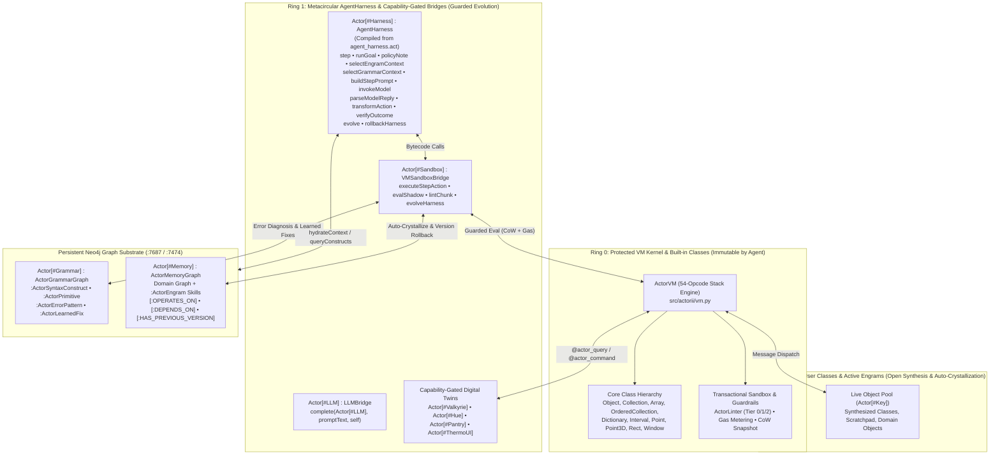
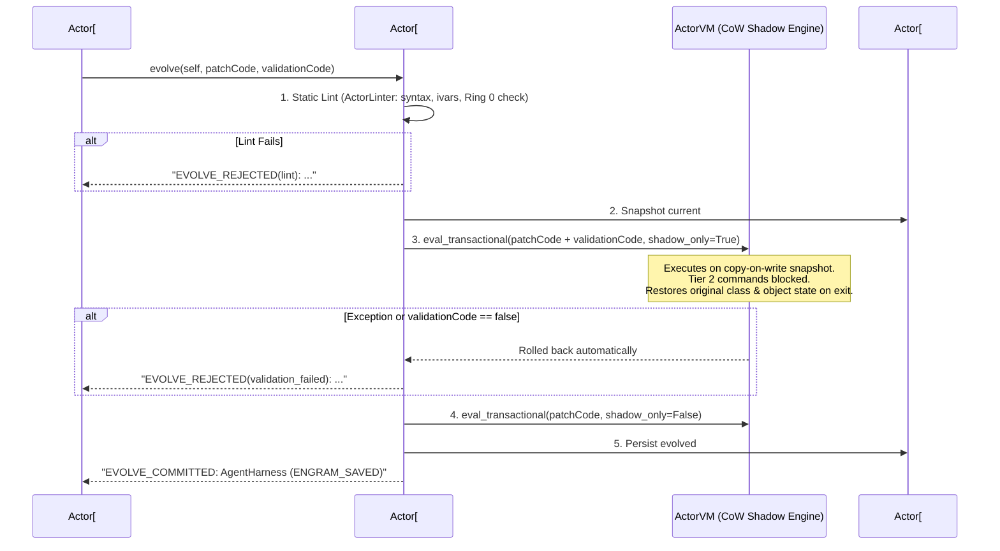

> [!WARNING]
> This is a planning document and should not be considered as a source of truth without verification.

# ActorII & The Metacircular AgentHarness: Architectural Blueprint

**Document Purpose**: Comprehensive architectural specification, design rationale, empirical evaluation, and forward roadmap for **ActorII** — a clean-room Actor bytecode virtual machine, live object-image runtime, Neo4j Engram memory engine, and metacircular self-mutable LLM agent harness. Designed both as an internal engineering blueprint and as a standalone technical specification for external architectural review.

---

## 1. Executive Thesis & Problem Statement

### 1.1 Why Conventional LLM Agent Harnesses Hit a Wall
Almost every modern AI agent framework (LangChain, AutoGen, OpenAI Tool Calling, Claude Code, Hermes Agent) is built around the same architectural pattern: a **stateless external loop** written in Python or TypeScript that sends a growing conversation transcript plus **thousands of tokens of static JSON tool schemas** to an LLM, parses a JSON tool call, executes an isolated function or shell subprocess, and serializes the text output back into the prompt.

When deployed on local or bounded-context hardware (e.g., a 20B–27B parameter model running on a single 16 GB GPU), this conventional architecture suffers from three structural bottlenecks:

1. **The Tool-Schema Token Tax**:
   - A general-purpose agent harness typically prepends `12,000–18,000` input tokens of JSON tool definitions and system boilerplate on *every single turn*.
   - In our 30-task head-to-head benchmark on `qwen3.8:latest` (27.3B Dense), the standard CLI agent harness (`Hermes Agent`) consumed **385,513 tokens** (`~16,136` tokens/turn), whereas `ActorII` solved the exact same 30 tasks in **132,445 tokens** (**65.6% fewer tokens**) and **2.5x faster** (`31.6s` vs. `79.1s` per task) while nearly doubling accuracy (**93.3% vs. 46.7%**).
2. **The Code-vs-State Impedance Mismatch**:
   - In JSON tool-calling harnesses, *code* and *state* live in separate worlds. Every intermediate data structure must be flattened into text between turns, or written to ad-hoc temporary files.
   - When an agent solves a problem in Turn 1, that capability evaporates when the process exits unless a human manually packages it into a new tool plugin.
3. **Opaque, Non-Reflective Control Loops**:
   - In a standard Python harness, the agent's cognitive loop (context retrieval, prompt assembly, action filtering, outcome verification, retry policy) is hardcoded in host Python files outside the agent's runtime environment.
   - The agent cannot inspect, override, or safely evolve how it thinks at runtime without modifying host source files on disk and restarting its own process.

### 1.2 The Core Insight of `ActorII`
What if, instead of bolting an LLM onto the outside of a stateless JSON tool dispatcher, **the LLM lived inside a reflective, transactional, Smalltalk-style object image where the harness itself is just another live object in memory?**

In `ActorII`:
- **Tools are not JSON schemas** — they are live objects in a shared global dictionary (`Actor[#Memory]`, `Actor[#Sandbox]`, `Actor[#Valkyrie]`, `Actor[#Hue]`, `Actor[#Pantry]`, plus any new classes the agent compiles).
- **Actions are not JSON blobs** — every agent turn emits concise **Actor code** (`!!`-terminated chunks) that compiles directly into VM bytecode, mutates or queries live objects in RAM, and returns real typed values.
- **Memories are not passive text chunks** — when the agent writes a class to solve a domain or graph problem, `Actor[#Memory]` automatically crystallizes the compiled class into Neo4j as a versioned **`:ActorEngram`** node linked to the graph schema (`[:OPERATES_ON]`, `[:DEPENDS_ON]`). On future sessions—even after a cold VM reboot—relevant Engrams hydrate directly into `Actor[...]` in **0 LLM tokens**.
- **The Harness is Metacircular and Self-Mutable** — `Actor[#Harness]` is an instance of the `AgentHarness` class compiled from [`agent_harness.act`](src/actorii/harness/agent_harness.act) into Actor bytecode. Its cognitive hooks (`policyNote`, `selectEngramContext`, `selectGrammarContext`, `transformAction`, `verifyOutcome`, `step`, `runGoal`) are first-class Actor methods that the agent can inspect and hot-patch in live RAM inside a guarded copy-on-write shadow transaction (`evolve(Actor[#Harness], patchCode, validationCode)!!`).

---

## 2. Why the Actor Language? (Solving the Smalltalk + LLM Paradox)

### 2.1 The Smalltalk + LLM Paradox
Researchers and practitioners (such as the Pharo/Glamorous Toolkit `gt4llm` community) have long recognized that a Smalltalk image is theoretically the ideal substrate for an AI agent: code and state are unified in a single live object graph, every object is inspectable, and `doesNotUnderstand:` allows dynamic method synthesis on the fly.

However, traditional Smalltalk-80 hits a practical wall with modern LLMs: **syntax hallucination**.
- Smalltalk's keyword-message syntax (`aCollection inject: 0 into: [:sum :each | sum + each]`) and precedence rules (unary > binary > keyword, strict left-to-right binary evaluation without standard arithmetic precedence) conflict heavily with LLM pretraining corpora, which are dominated by C, Python, JavaScript, and Java.
- Local 12B–27B models frequently hallucinate dot calls (`obj.method()`), curly braces, or standard operator precedence inside Smalltalk code.

### 2.2 Why Actor Is the Sweet Spot
Originally created by Charles Duff at The Whitewater Group, **Actor** is a pure, single-rooted, Smalltalk-80 object-oriented language (`Object` at the root, late-bound message passing, lexical closures, live image snapshots `ACTOR.IMG`) designed specifically with **C/Pascal prefix syntax**:

| Language Feature | Smalltalk-80 / Pharo | Actor (`ActorII`) | Why Actor Fits LLMs Better |
| :--- | :--- | :--- | :---
| **Message Dispatch** | `receiver selector: arg1 with: arg2` | `selector(receiver, arg1, arg2)` | Matches standard functional/C call syntax (`fn(obj, a, b)`) in LLM pretraining. |
| **Method Body & Blocks** | `[ :x \| x + 1 ]` / period `.` separators | `Def m(self, x \| loc) { ^x + 1; }!!` | Uses familiar `{ ... }` braces, `;` statement terminators, and `!!` chunk delimiters. |
| **Control Flow** | `cond ifTrue: [...] ifFalse: [...]` | `if (cond) then ... else ... endif;` / `loop while (cond) begin ... endLoop;` | Explicit structured keywords (`if/then/else/endif;`, `loop/while/begin/endLoop;`) that are trivial to lint and repair. |
| **Object Model** | Pure single-root OOP (`Object`) + Live Image | Pure single-root OOP (`Object`) + Live Image (`ACTOR.IMG`) | Retains 100% of Smalltalk's live image, reflection, and `doesNotUnderstand` power. |

---

## 3. System Architecture & Protection Rings



### 3.1 The Three Capability Rings
To resolve the tension between **open-ended self-modification** and **host/runtime safety**, `ActorII` partitions the object world into three explicit rings:

1. **Ring 0 — Protected System Kernel (`PROTECTED_SYSTEM_CLASSES`)**:
   - Includes `Object`, `Collection`, `IndexedCollection`, `Array`, `OrderedCollection`, `List`, `Set`, `Dictionary`, `Interval`, `Point`, `Point3D`, `Rect`, `String`, `Number`, `Int`, `Float`, `Symbol`, `Agent`, `VMSandbox`, `ActorGrammarGraph`, and `ActorMemoryGraph`.
   - Enforced statically by [`ActorLinter`](src/actorii/guardrails/linter.py) (`[SYS_PROTECTED_CLASS]`): any attempt by LLM-generated Actor code to overwrite a method on a Ring 0 class is rejected before bytecode execution begins.
2. **Ring 1 — Metacircular `AgentHarness` & Capability-Gated Python Bridges**:
   - **Python Bridges (`@actor_bridge`)**: Python services exposed into `Actor[...]` (such as `Actor[#Sandbox]`, `Actor[#Memory]`, `Actor[#Grammar]`, `Actor[#Valkyrie]`, `Actor[#Hue]`) use explicit capability decorators:
     - `@actor_query` (**Tier 0 Read-Only**): Safe to call during speculative shadow dry-runs (`shadow_only=True`).
     - `@actor_command` (**Tier 2 Side-Effecting**): Audited in `bridge.audit_log` and automatically blocked during speculative shadow runs (`shadow_only=True`) so dry-runs never trigger physical hardware or mutate external state.
   - **Metacircular `AgentHarness` (`Actor[#Harness]`)**: Lives in Ring 1. Unlike Ring 0, `#AgentHarness` **is** mutable by the agent—but safely gated through `evolve(Actor[#Harness], patchCode, validationCode)!!` (`VMSandboxBridge.evolveHarness`), which validates every self-patch in a copy-on-write shadow transaction and versions `#AgentHarness` in Neo4j before committing.
3. **Ring 2 — Open User & Skill Space (`Actor[#ClassName]`)**:
   - The agent can freely define new classes (`inherit(Object, #MySkill, #(#ivar1), 1, nil)!!`), compile methods (`Def compute(self, x | y) { ... }!!`), instantiate objects in `Actor[...]`, and hot-patch user classes.
   - Every valid user class with compiled methods is automatically crystallized into Neo4j as a reusable `:ActorEngram` skill at the end of the step (`0` extra LLM tokens).

---

## 4. Deep Dive: The Metacircular `AgentHarness`

### 4.1 Why "Metacircular"?
In programming language theory (Reynolds, 1972; Abelson & Sussman, *SICP*; Gregor Kiczales, *The Art of the Metaobject Protocol*), an interpreter or runtime is **metacircular** when it is written in the same language it executes, and **reflective** when the running program can inspect and modify the structures that govern its own execution.

In `ActorII`, `AgentHarness` ([`src/actorii/harness/agent_harness.act`](src/actorii/harness/agent_harness.act)) is a compiled subclass of `Agent` written in Actor and loaded directly into the VM's class hierarchy:

```actor
inherit(Agent, #AgentHarness, #(
    #sandbox
    #goal
    #status
    #stepCount
    #maxSteps
    #failures
    #maxFailures
    #scratchpad
    #stepLog
    #lastAction
    #lastResult
    #lastError
    #gasLimit
    #totalGasUsed
), 14, nil)!!
```

### 4.2 The Overridable Cognitive Pipeline in Bytecode
Every tick of the agent (`step(Actor[#Harness])!!`) executes as compiled Actor bytecode that dispatches through eight overridable cognitive methods on `self` (building the prompt directly in Actor bytecode and invoking `complete(Actor[#LLM], promptText, self)`):

```actor
Def policyNote(self) {
    ^"";
}!!

Def selectEngramContext(self, goalText) {
    if Actor[#Memory] == nil then
        ^"";
    endif;
    ^hydrateContext(Actor[#Memory], goalText);
}!!

Def selectGrammarContext(self, goalText) {
    if Actor[#Grammar] == nil then
        ^"";
    endif;
    ^queryConstructsForTask(Actor[#Grammar], goalText, "", "");
}!!

Def instructionBlock(self) {
    ^defaultInstructions(self.sandbox);
}!!

Def buildStepPrompt(self, engramCtx, grammarCtx, policyTxt | p turnsTxt stepsTxt errTxt instTxt) {
    p := "You are executing inside the 1993 Whitewater Actor 4.1 bytecode virtual machine (`ActorII`).\n";
    p := p + "GOAL: " + asString(self.goal) + "\n";
    p := p + "STEP: " + asString(self.stepCount) + " of " + asString(self.maxSteps) + "\n";
    p := p + "SCRATCHPAD (`Actor[#Harness].scratchpad`): " + formatScratchpad(self.sandbox, self) + "\n";
    p := p + "LAST RESULT: " + formatLastResult(self.sandbox, self) + "\n";
    p := p + "LIVE POOL SUMMARY: " + poolSummary(self.sandbox);
    if policyTxt <> "" then
        p := p + "\n\n[HARNESS RUNTIME POLICY OVERRIDE]:\n" + policyTxt;
    endif;
    if engramCtx <> "" then
        p := p + "\n\n" + engramCtx;
    endif;
    turnsTxt := formatRecentTurns(self.sandbox, self);
    if turnsTxt <> "" then
        p := p + "\n\n" + turnsTxt;
    endif;
    stepsTxt := formatStepHistory(self.sandbox, self);
    if stepsTxt <> "" then
        p := p + "\n\n" + stepsTxt;
    endif;
    if grammarCtx <> "" then
        p := p + "\n\n" + grammarCtx;
    endif;
    if self.lastError <> "" then
        errTxt := formatErrorDiagnostic(self.sandbox, self);
        p := p + "\n\n" + errTxt;
    endif;
    instTxt := instructionBlock(self);
    if instTxt <> "" then
        p := p + "\n\n" + instTxt;
    endif;
    ^p;
}!!

Def invokeModel(self, promptText) {
    ^complete(Actor[#LLM], promptText, self);
}!!

Def parseModelReply(self, rawReply) {
    ^extractAction(self.sandbox, rawReply);
}!!

Def transformAction(self, rawAction) {
    ^rawAction;
}!!

Def verifyOutcome(self, outcome) {
    ^true;
}!!

Def evolve(self, patchCode, validationCode) {
    ^evolveHarness(self.sandbox, self, patchCode, validationCode);
}!!

Def rollbackHarness(self) {
    if Actor[#Memory] == nil then
        ^"ERROR: Memory graph disabled";
    endif;
    ^rollbackEngram(Actor[#Memory], #AgentHarness);
}!!

Def step(self | engramCtx grammarCtx policyTxt promptText rawReply rawAction actionText outcome ok) {
    if self.status == #complete then
        ^self.lastResult;
    endif;
    if self.failures >= self.maxFailures then
        self.status := #blocked;
        ^"HALT: Circuit breaker tripped";
    endif;
    if self.stepCount >= self.maxSteps then
        self.status := #halted;
        ^"HALT: Max steps reached";
    endif;

    self.stepCount := self.stepCount + 1;
    self.status := #running;

    engramCtx := selectEngramContext(self, self.goal);
    grammarCtx := selectGrammarContext(self, self.goal);
    policyTxt := policyNote(self);

    promptText := buildStepPrompt(self, engramCtx, grammarCtx, policyTxt);
    rawReply := invokeModel(self, promptText);
    rawAction := parseModelReply(self, rawReply);
    actionText := transformAction(self, rawAction);
    self.lastAction := actionText;

    outcome := executeStepAction(self.sandbox, self, actionText, self.gasLimit);
    if self.lastError == "" then
        ok := verifyOutcome(self, outcome);
        if ok == false then
            outcome := rejectStepOutcome(self.sandbox, self, "verifyOutcome(self, outcome) rejected step result");
        endif;
    endif;
    ^outcome;
}!!
```

### 4.3 What Live Self-Modification Enables
Because `step(self)` calls `selectEngramContext`, `selectGrammarContext`, `policyNote`, `transformAction`, and `verifyOutcome` dynamically via late-bound message dispatch on `self`, the agent can alter its own runtime behavior in real time without restarting Python:

1. **Custom Domain Verification (`verifyOutcome`)**:
   - Suppose the agent is solving a physics or financial optimization task where negative outputs or `nil` values are invalid even if they compile and run without throwing an exception.
   - The agent can hot-patch `Def verifyOutcome(self, outcome) { if (outcome < 0) then ^false; endif; ^true; }!!`.
   - If Step 1 produces `-5`, `verifyOutcome` returns `false`, `rejectStepOutcome` flips `self.status` back to `#running`, records `OutcomeVerificationError`, and forces Step 2 to self-correct.
2. **Custom Cognitive Policies (`policyNote` & `selectEngramContext`)**:
   - The agent (or a supervisor) can evolve `Def policyNote(self)` to inject domain-specific constraints into its own planning prompt, or override `selectEngramContext(self, goalText)` to filter which Neo4j Engrams are hydrated for a specialized workflow.
3. **Pre-Execution Action Rewriting (`transformAction`)**:
   - The agent can override `Def transformAction(self, rawAction)` to instrument, wrap, or sanitize planned code chunks before `executeStepAction` evaluates them.

### 4.4 Guarded Self-Modification Lifecycle (`evolve` & `rollbackHarness`)
Unchecked self-modification in a live image carries an obvious hazard: if an agent compiles a broken method onto `AgentHarness`, it could break its own `step` loop ("bricking the image").

`VMSandboxBridge.evolveHarness` ([`src/actorii/harness/__init__.py`](src/actorii/harness/__init__.py#L794-L868)) prevents this via a 4-stage transactional pipeline:



If an evolved behavior later proves undesirable across subsequent tasks, calling `rollbackHarness(Actor[#Harness])!!` (or `/harness rollback` in `actor-tui`) pops the previous `:ActorEngramVersion` from Neo4j, clears stale methods on `AgentHarness`, and re-compiles the prior version in RAM in `< 15ms`.

---

## 5. Dual Neo4j Graph Architecture: Syntax Self-Healing + Active Engrams

A persistent weakness of code-generating agents is that they start every session with amnesia—re-making the same syntax mistakes and re-writing the same helper classes from scratch. `ActorII` solves both problems using two specialized Neo4j graph bridges exposed directly into the `Actor[...]` pool.

### 5.1 `Actor[#Grammar]` (`ActorGrammarGraph`) — Self-Learning Compiler Remediation
Implemented in [`src/actorii/harness/grammar_graph.py`](src/actorii/harness/grammar_graph.py):
- **Seeded Knowledge Graph**: Stores `:ActorSyntaxConstruct` nodes (method definitions with pipe `|` local declarations, `if/then/else/endif;`, `loop/while/begin/endLoop;`, integer vs. float division, prefix dispatch, Cypher quoting), `:ActorBuiltinClass` $\to$ `:ActorPrimitive` signatures, and `:ActorErrorPattern` nodes linked via `[:REMEDIATED_BY]`.
- **Scoped Pre-Generation Retrieval (`queryConstructsForTask`)**: Injects compact, task-relevant Actor grammar rules and primitive signatures (`~400` tokens instead of `16,000` tokens of JSON tool schemas). Graph/Cypher constructs are dynamically scoped so pure algorithmic tasks only receive core language primitives.
- **Closed-Loop Error Learning (`diagnoseError` $\to$ `recordLearnedFix`)**:
  1. If Step $k$ fails with a `ParseError`, `ActorGuardrailError`, or runtime exception, `diagnoseError(last_error)` queries Neo4j for matching `:ActorErrorPattern` rules and any previously learned `:ActorLearnedFix` examples.
  2. When Step $k+1$ succeeds after an error on Step $k$, `recordLearnedFix` automatically writes a new `(:ActorErrorPattern)-[:HAS_LEARNED_FIX]->(:ActorLearnedFix)` edge in Neo4j recording the exact failed code and repaired code.

### 5.2 `Actor[#Memory]` (`ActorMemoryGraph`) — Active `:ActorEngram` Memory-Skills
Implemented in [`src/actorii/harness/memory_graph.py`](src/actorii/harness/memory_graph.py):
- **The Problem with Passive Memory**: Standard agent memory systems (vector RAG, Markdown notes, or raw Cypher queries) store *facts*, not *verified executable procedures*. Even when a fact is retrieved, the LLM still has to spend thousands of tokens synthesizing code to filter, join, and compute over those facts on every session.
- **What an `:ActorEngram` Is**: An `:ActorEngram` is a compiled, verified Actor class persisted in Neo4j alongside its `.act` source code, callable method signatures, version history (`:ActorEngramVersion`), and explicit graph topology edges:
  - `(:ActorEngram)-[:OPERATES_ON]->(:ActorGraphDomain {label: ...})`: Automatically extracted from Cypher `MATCH (n:Label)` / `MERGE (n:Label)` patterns inside the class's methods.
  - `(:ActorEngram)-[:DEPENDS_ON]->(:ActorEngram)`: Automatically extracted when one Engram dispatches messages to another `Actor[#OtherEngram]` object.
  - `(:ActorEngram)-[:HAS_PREVIOUS_VERSION]->(:ActorEngramVersion)`: Created automatically whenever an existing Engram is hot-patched with updated bytecode.
- **Zero-Token Post-Step Auto-Crystallization (`auto_crystallize_from_chunk`)**:
  - The agent does **not** need to remember to call `saveEngram` or `persistEngram` during a task (which would cost an extra ReAct step and extra tokens).
  - Whenever `executeStepAction` commits a step that defines or updates a user class with compiled methods, `auto_crystallize_from_chunk` automatically files out the class via [`ActorFileOutManager`](src/actorii/guardrails/fileout.py) and persists it as an `:ActorEngram` in Neo4j with **0 LLM token overhead**.
- **Cold-Boot Hydration (`hydrateRelevantEngrams`)**:
  - When a new VM boots cold (empty RAM) and receives a goal, `selectEngramContext` queries Neo4j for matching `:ActorEngram` nodes, topologically loads any `[:DEPENDS_ON]` prerequisites first, compiles the Engram classes directly into `Actor[#ClassName]`, and surfaces their 1-line call signatures in the prompt.

---

## 6. Empirical Benchmark Evidence

All benchmarks below were executed live on `valkyrie` (Fedora Linux 44, NVIDIA RTX 5070 Ti 16 GB VRAM) with zero mock providers or synthetic scores.

### 6.1 Suite 1: Official OpenAI HumanEval ($N=12$) & GSM8K ($N=8$) Across Local Models
Full report: [`benchmarks/BENCHMARK_REPORT.md`](benchmarks/BENCHMARK_REPORT.md).

| Local Model (`valkyrie` `:8080`) | Architecture & Footprint | OpenAI HumanEval ($N=12$) Pass@Harness | HumanEval 1-Shot (Step 1) | HumanEval Cold-Boot Engram Recall | OpenAI GSM8K ($N=8$) Pass@Harness |
| :--- | :--- | :---: | :---: | :---: | :---: |
| **`qwen3.8:latest` + Active Engrams** | 27.3B Dense (`Q4_K_M`, 16.0 GB) | **12/12 (100.0%)** | **12/12 (100.0%)** | **12/12 (100.0%, 0 tokens)** | **8/8 (100.0%)** |
| **`gpt-oss:20b` + Neo4j Grammar** | 20.9B MoE (3.6B active, 13.0 GB) | **12/12 (100.0%)** | 11/12 (91.7%) | — | **8/8 (100.0%)** |
| **`gemma4:e4b`** | 8.0B Dense (`Q4_K_M`, 8.9 GB) | **11/12 (91.7%)** | 8/12 (66.7%) | — | **7/8 (87.5%)** |
| **`qwen2.5-coder-cpu:7b`** | 7.6B Dense (CPU `:11434`, 0 MB VRAM) | **10/12 (83.3%)** | 6/12 (50.0%) | — | **6/8 (75.0%)** |

### 6.2 Suite 2: Controlled 3-Mode Active Engram Ablation (`gpt-oss:20b`, 12 Tasks Across Cold VM Reboots)
Full report: [`benchmarks/ENGRAM_AB_REPORT.md`](benchmarks/ENGRAM_AB_REPORT.md).
Tests 4 multi-domain graph + computation scenarios across 3 phases (**Phase 1**: Skill Acquisition; **Phase 2**: Cold VM Reboot Recall after wiping RAM; **Phase 3**: Multi-Hop Composition + Live Hot-Patching):

| Metric | Mode A: RAM-Only (`enable_memory_graph=False`) | Mode B: Passive Neo4j Cypher (`enable_engrams=False`) | Mode C: Active Neo4j Engrams (`enable_engrams=True`) | Mode C Advantage (vs. Passive Cypher) |
| :--- | :---: | :---: | :---: | :---: |
| **Overall Accuracy (12 Tasks)** | 0/12 (0.0%) | 8/12 (66.7%) | **12/12 (100.0%)** | **+33.3% accuracy** |
| **Phase 2 Cold-Reboot Recall** | 0/4 (0.0%) | 4/4 (100.0%) | **4/4 (100.0%)** | **-58.1% tokens / -67.8% latency** |
| **Phase 3 Composition & Hot-Patch** | 0/4 (0.0%) | 0/4 (0.0%) | **4/4 (100.0%)** | **+100.0% accuracy** |
| **Total Tokens Consumed** | 225,841 | 114,507 | **44,837** | **-60.8% tokens** |
| **Avg Latency / Task** | 37.90s | 21.12s | **5.35s** | **3.95x faster (-74.7%)** |

### 6.3 Suite 3: 30-Task Head-to-Head Showdown (`ActorII AgentHarness` vs. `Hermes Agent` on `qwen3.8:latest`)
Full report: [`benchmarks/ACTOR_VS_HERMES_REPORT.md`](benchmarks/ACTOR_VS_HERMES_REPORT.md).
Both harnesses ran against the exact same local `qwen3.8:latest` (27.3B Dense) server on `:8080` across 30 tasks (15 unseen OpenAI HumanEval tasks, 10 unseen OpenAI GSM8K word problems, and 5 Cold-Reboot Persistent Graph Memory + Computation tasks):

| Benchmark Track | `ActorII AgentHarness` Accuracy | `Hermes Agent` Accuracy | `ActorII` Total Tokens | `Hermes` Total Tokens | `ActorII` Avg Latency | `Hermes` Avg Latency |
| :--- | :---: | :---: | :---: | :---: | :---: | :---: |
| **Track 1: Unseen OpenAI HumanEval ($N=15$)** | **14/15 (93.3%)**<br/>*(+ 14/15 0-token Engram recall)* | 8/15 (53.3%) | **40,414** | 156,730 | **33.15s** | 74.07s |
| **Track 2: Unseen OpenAI GSM8K ($N=10$)** | **9/10 (90.0%)** | 6/10 (60.0%) | **74,902** | 212,282 | **40.30s** | 71.06s |
| **Track 3: Cold-Reboot Graph Memory ($N=5$)** | **5/5 (100.0%)** | 0/5 (0.0%) | **17,129** | 16,501 *(timed out)* | **9.55s** | 110.05s |
| **Overall 30-Task Total** | **28/30 (93.3%)** | **14/30 (46.7%)** | **132,445** | **385,513** | **31.60s** | **79.13s** |

### 6.4 Suite 4: Containerized Multi-Harness Benchmark (`ActorII` vs. `pi` vs. `Hermes` in Vanilla Docker Containers)
Full report: [`benchmarks/INDUSTRY_SUITE_REPORT.md`](benchmarks/INDUSTRY_SUITE_REPORT.md) | Runner: [`benchmarks/run_industry_harness_suite.py`](benchmarks/run_industry_harness_suite.py).
Each harness ran in a fresh, isolated Docker container (`docker run --init --rm`) against unmodified third-party benchmark instances (`princeton-nlp/SWE-bench_Lite`, `openai/openai_humaneval`, `google-research-datasets/mbpp` sanitized, and `openai/gsm8k`):

| Containerized Harness | Docker Image | Tasks Passed | Pass Rate (%) | SWE-bench Lite (`N=2`) | HumanEval (`N=2`) | Google MBPP (`N=2`) | OpenAI GSM8K (`N=2`) | Avg Latency / Task |
| :--- | :--- | :---: | :---: | :---: | :---: | :---: | :---: | :---: |
| **`ActorII`** | `actorii-sandbox:latest` | **8/8** | **100.0%** | **2/2 (100%)** | **2/2 (100%)** | **2/2 (100%)** | **2/2 (100%)** | **66.81s** |
| **`Hermes`** | `hermes-bench:latest` | **7/8** | **87.5%** | 1/2 (50%) | **2/2 (100%)** | **2/2 (100%)** | **2/2 (100%)** | 81.65s |
| **`pi`** (`v0.86.1`) | `pi-bench:latest` | **6/8** | **75.0%** | 0/2 (0%) | **2/2 (100%)** | **2/2 (100%)** | **2/2 (100%)** | 83.04s |

---

## 7. Stack Integration Pattern: Peer Service vs. Embedded Library

A critical architectural decision is how `ActorII` relates to the rest of the host stack (such as `Hermes Agent` / Bilby on `valkyrie`, or Cloud Skippy):

- **Anti-Pattern (Flattening into a Passive Tool Library)**:
  - Importing `ActorVM` as a stateless Python helper inside a conventional JSON tool-calling harness would throw away `ActorII`'s two decisive advantages: you would immediately pay the `16,136`-token JSON schema tax again, and you would lose the persistent, self-mutating `Actor[#Harness]` object image.
- **Adopted Pattern (Autonomous Peer Runtime with Delegation Bridge)**:
  - `ActorII` runs as a **first-class peer runtime** with its own live object pool, Neo4j Engram memory, TUI (`actor-tui`), and HTTP/WebSocket Studio daemon (`:8090` / `:8765`).
  - General-purpose operational agents (Hermes / Bilby, Cloud Skippy, cron pipelines) delegate algorithmic synthesis, stateful Digital Twin orchestration, and Neo4j graph + computation goals to `ActorII` over a lightweight peer bridge:
    - **CLI Bridge**: `ask-actorii` (`ask-actorii "<goal>"`, `ask-actorii --eval "<code>!!"`, `ask-actorii --engrams`, `ask-actorii --harness`).
    - **Hardened HTTP & WebSocket Bridge**: Loopback-default binding (`127.0.0.1`), `POST` + `X-Actor-Request: 1` anti-CSRF enforcement on mutating endpoints (`/api/goal`, `/api/eval`, `/api/chat/clear`, `/api/harness/evolve`), `Origin`/`Sec-Fetch-Site` validation, optional `ACTORII_STUDIO_TOKEN` Bearer auth, and `asyncio.Lock` VM serialization in [`websocket_server.py`](websocket_server.py).

---

## 8. Key File Map & Verification Commands

| Subsystem | Source Path | Description |
| :--- | :--- | :--- |
| **Metacircular Harness Bytecode** | [`src/actorii/harness/agent_harness.act`](src/actorii/harness/agent_harness.act) | Actor class `#AgentHarness` (`step`, `runGoal`, `buildStepPrompt`, `invokeModel`, `parseModelReply`, `compactContext`, `setTaskContract`, `spawnSubGoal`, `verifyOutcome`, `evolve`, `rollbackHarness`). |
| **Sandbox, LLM & Evolution Bridge** | [`src/actorii/harness/__init__.py`](src/actorii/harness/__init__.py) | `LLMBridge` (`Actor[#LLM]`: `complete`, `countTokens`), `VMSandboxBridge` (`Actor[#Sandbox]`: `executeStepAction`, `rejectStepOutcome`, `compactChatHistory`, `forkHarness`, `evolveHarness`), pluggable `load_harness_system_prompt`. |
| **Host CoW VFS & VM Reflection** | [`src/actorii/harness/host_bridge.py`](src/actorii/harness/host_bridge.py) | `HostWorkspaceBridge` (`Actor[#Host]`: `readFile`, `writeFile`, `editFile`, `execShell` with CoW Shadow VFS) and `VMReflectionBridge` (`Actor[#VM]`: `classes`, `ringOf`, `methodsOf`, `sourceOf`, `ivarsOf`). |
| **Neo4j Active Engram Engine** | [`src/actorii/harness/memory_graph.py`](src/actorii/harness/memory_graph.py) | `ActorMemoryGraph` (`Actor[#Memory]`), runtime call-stack `[:OPERATES_ON]` tracking, warm-image reconciliation, `initializeClass` hook, `:8084` vector + graph hybrid scoring, `recordEngramUsage`. |
| **Neo4j Grammar & Error Graph** | [`src/actorii/harness/grammar_graph.py`](src/actorii/harness/grammar_graph.py) | `ActorGrammarGraph` (`Actor[#Grammar]`), `queryConstructsForTask`, `diagnoseError`, `recordLearnedFix`. |
| **Bytecode VM & Transactions** | [`src/actorii/vm.py`](src/actorii/vm.py) | 54-opcode stack-frame VM, `eval_chunk`, `eval_transactional` (`shadow_only` snapshot rollback + frame local capture), gas metering. |
| **Guardrails, Linter & File-Out** | [`src/actorii/guardrails/linter.py`](src/actorii/guardrails/linter.py) | `ActorLinter` (Risk Tiers 0/1/2, `PROTECTED_SYSTEM_CLASSES`, strict ivar checks), `ActorCodeJudge`, `ActorFileOutManager`. |
| **Whole-Image Persistence** | [`src/actorii/image.py`](src/actorii/image.py) | Reference-preserving `ACTOR.IMG` serializer/deserializer (`save_image`, `load_image`, `snapshot_to_dict`). |
| **Terminal UI & Dock** | [`src/actorii/tui.py`](src/actorii/tui.py) | `actor-tui` / `bilby` console & split-pane Curses dock (`/goal`, `/harness`, `/evolve`, `/engrams`, `/shadow`, `/lint`). |
| **Hardened Studio Server** | [`websocket_server.py`](websocket_server.py) | HTML5/WebSocket Visual Studio & HTTP peer API with CSRF/Origin/Bearer hardening and sparse surface storage. |

### Reproducible Verification Suite
```bash
# 1. Run the full verification suite (grammar, compiler, VM, guardrails, Engrams, metacircular & security hardening)
PYTHONPATH=src pytest tests/ -q

# 2. Run the M15 metacircular self-modification & live LLM evolution tests
PYTHONPATH=src pytest tests/test_metacircular_self_mutation.py -v

# 3. Run the M16 Pi-class harness evolution suite
PYTHONPATH=src pytest tests/test_pi_class_harness_evolution.py -v

# 4. Run the Bilby containment, WebSocket CSRF/Origin/Auth & persona hardening suite
PYTHONPATH=src pytest tests/test_bilby_security_hardening.py -v
```

---

## 9. Milestone M16 Resolutions: Pi-Class Self-Mutable Harness Evolution

Following external architectural review (*ActorII Architectural Review & Pi-Class Harness Evolution Spec*), the four open design questions were resolved and implemented directly in the runtime:

1. **Direct Model Invocation & Bytecode Token-Budget Compaction (`Actor[#LLM]`, `compactContext`)**:
   - `AgentHarness` constructs its full prompt in Actor bytecode (`buildStepPrompt(self, engramCtx, grammarCtx, policyTxt)`), checks `countTokens(Actor[#LLM], promptText) > self.tokenBudget`, and automatically triggers `compactContext(self, 2)` in bytecode before calling `complete(Actor[#LLM], promptText, self)`.
   - During `shadow_only=True` (`dryRun` / `evolveHarness`), `LLMBridge.complete` returns a deterministic stub (`"COMPLETE: Shadow dry-run stub"`) unless `#allowShadow` is explicitly passed.
2. **Task-Scoped `#taskContract` Post-Condition Contracts (`setTaskContract` / `clearTaskContract`)**:
   - Rather than mutating Ring 1 `AgentHarness` on every task, `AgentHarness` holds a `#taskContract` ivar (`setTaskContract(self, contractObj)`). `verifyOutcome(self, outcome)` dispatches `if self.taskContract <> nil then ^check(self.taskContract, outcome); endif; ^true;` in Ring 2 while keeping `evolve(self, ...)` reserved for genuine Ring 1 cognitive upgrades.
3. **Transactional Host Workspace (`Actor[#Host]`) with Copy-on-Write VFS & Deep VM Reflection (`Actor[#VM]`)**:
   - `HostWorkspaceBridge` (`Actor[#Host]`) exposes `readFile`, `writeFile`, `editFile`, and `execShell`. During `shadow_only=True`, `writeFile` and `editFile` (`@actor_command(shadow_safe=True)`) stage edits into an in-memory Copy-on-Write VFS overlay (`_shadow_vfs`) that is readable by `readFile` inside the shadow run and automatically discarded on rollback, leaving physical disk untouched.
   - `VMReflectionBridge` (`Actor[#VM]`) exposes `classes`, `ringOf`, `methodsOf`, `sourceOf`, and `ivarsOf`, and step failures populate a structured `lastErrorContext` `Dictionary` (`#errorKind`, `#failedClass`, `#failedSelector`, `#bytecodeOffset`, `#localBindings`).
4. **Copy-on-Write Sub-Agent Forking (`spawnSubGoal` / `forkHarness`) & Hardened `:ActorEngram` Lifecycle**:
   - `spawnSubGoal(self, subGoal, policyOverride, maxSteps)` forks an isolated child `ActorVM` + `AgentHarness` from a Copy-on-Write snapshot (`snapshot_to_dict()`), runs the sub-goal in isolation, and returns only the final result without polluting the parent's `chatLog` or `scratchpad`.
   - `ActorMemoryGraph` inspects `self.vm.call_stack` during `cypherQuery`/`cypherWrite` to record dynamic runtime `[:OPERATES_ON]` domain edges, reconciles warm instance `_fields` and runs `initializeClass(Actor[#Name])` on hydration, filters out `Tmp*`/`TaskContract*` classes from auto-crystallization, and ranks Engrams using a composite score combining `:8084` (`bge-small-en-v1.5`) vector cosine similarity, `:ActorGraphDomain` overlap, and execution reliability (`(success_count + 1) / (call_count + 2)`).

