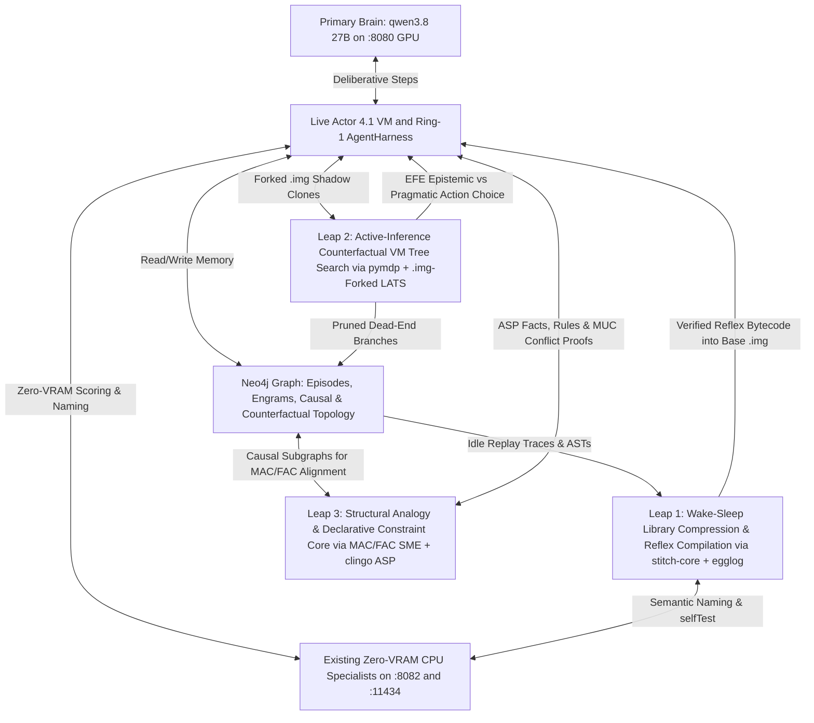
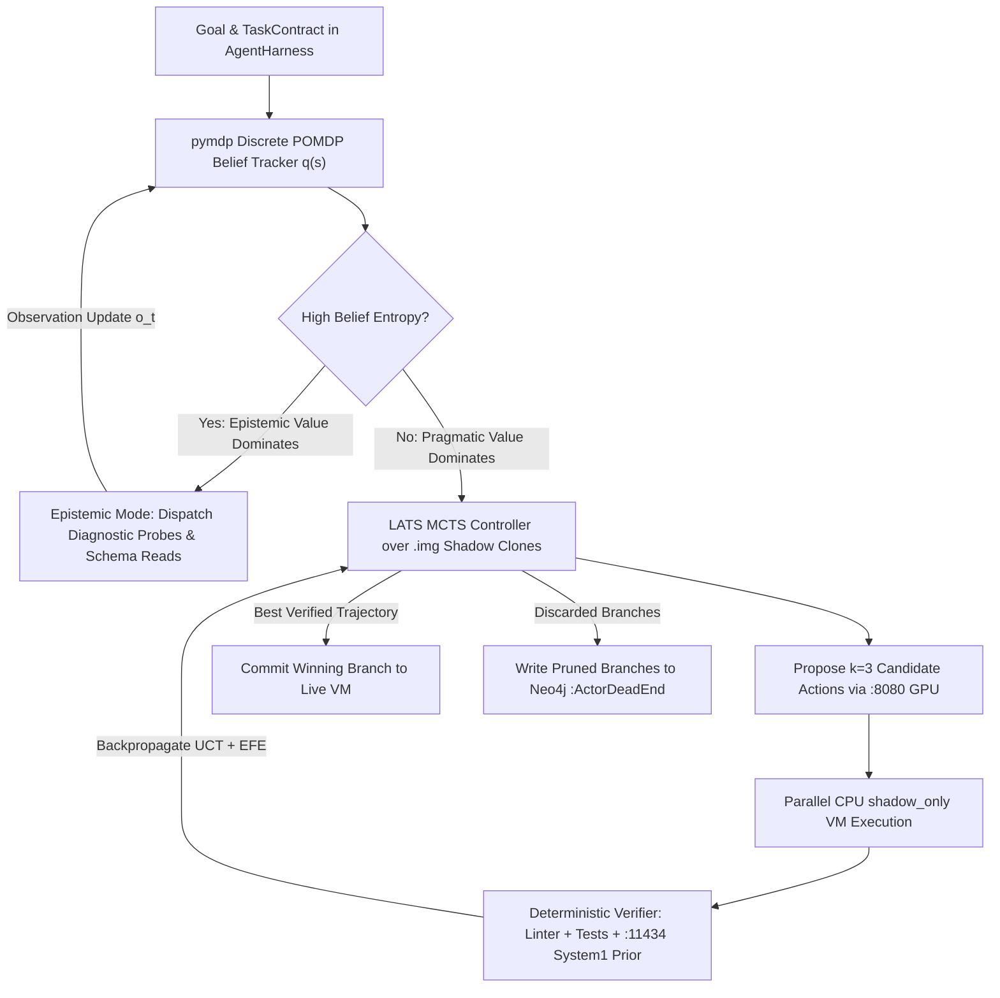
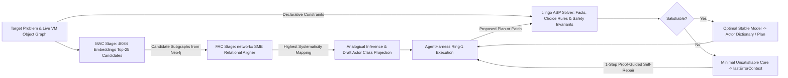
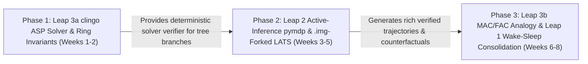

> [!WARNING]
> This is a planning document and should not be considered as a source of truth without verification.

# Bilby (`ActorII v4.5+`) Cognitive Architecture Upgrades: Three Neuro-Symbolic Leaps

**Author:** Cognitive-Systems Architecture Synthesis (`@architect-planner`, integrating cognitive science survey `#67` and LLM capability theory survey `#68`)  
**Target System:** Bilby (`ActorII v4.4.0` — 1993 Whitewater Actor 4.1 Metacircular VM + Neo4j Hybrid Graph + `qwen3.8:latest` 27B on `valkyrie`)  
**Hardware Constraint:** **Strictly `0 MB` additional GPU VRAM** (16.3 GB NVIDIA RTX 5070 Ti remains 100% reserved for `:8080` `qwen3.8:latest` at 65,536 context). All new engines run in `valkyrie`'s 32 GB CPU RAM alongside existing zero-VRAM CPU specialists (`:8082` `clef-flash-slot-8082`, `:11434` `clef-flash-cpu` / `qwen2.5-coder-cpu:7b`, `:8084` `bge-small-en-v1.5`).

---

## 1. Executive Synthesis & Architectural Thesis

### Why Tying a 1993 Actor VM to an LLM Worked — And Where the Next Ceiling Lies

Bilby's first emergent leap came from refusing to treat an LLM as a stateless text-to-bash wrapper. By embedding `qwen3.8:latest` inside a live, metacircular **1993 Actor 4.1 bytecode VM** (`src/actorii/vm.py`, `src/actorii/harness/agent_harness.act`) backed by lossless **Neo4j** memory (`:ActorEpisode`, `:ActorEngram`, `:ActorLearnedFix` in `src/actorii/harness/memory_graph.py`), Bilby achieved `94.60%` on LongMemEval-S, `81.82%` on Industry 8-Track, `100%` on HumanEval+GSM8K, and `4/4` blocking self-evolution canaries (`+38.46 pp` to `92.31%` on `#dag_task_scheduler`).

Yet Bilby's own hard-tier benchmark telemetry exposes **three fundamental cognitive ceilings** that prompt engineering and larger context windows cannot break:

1. **The Deliberation Tax & Engram Bloat (No Neocortical Consolidation):** Bilby's `:ActorEngram` store is append-only. Repeated multi-step patterns still burn 15 tok/s GPU deliberation on `:8080`, and learned classes accumulate redundant, un-factored variants without algebraic normalization or automatic abstraction.
2. **Myopic Linear ReAct Execution (No Counterfactual Lookahead or Epistemic Drive):** `AgentHarness>>step` executes a single greedy path. On high-ambiguity, multi-step engineering tasks — `ALE/cfr_game_theory_equilibrium` (`0.0000`, 23 steps, 194k tokens), `ALE/power_10kv_feeder_reliability_001` (`0.0000`, 32 steps, 649k tokens), and `TB2.1-Hard` (`1/3`, failing `feal-differential-cryptanalysis` and `llm-inference-batching-scheduler`) — Bilby commits to unverified hypotheses instead of probing ambiguity first or backtracking across forked VM states.
3. **Surface Retrieval & Combinatorial Brittleness (No Structural Analogy or Formal Constraint Core):** Dense cosine search (`:8084` `bge-small-en-v1.5`) retrieves by lexical/semantic surface overlap, missing cross-domain relational isomorphisms. Meanwhile, autoregressive decoding remains mathematically unreliable on hard combinatorial constraints, dependency scheduling, and formal invariants.

### The Tri-System Upgrade Thesis

Rather than bolting generic chatbot plugins onto Bilby, we commit to **three orthogonal, deeply synergistic neuro-symbolic engines** that exploit properties *unique* to ActorII (its live bytecode AST, microsecond `.img` copy-on-write snapshots, and explicit Neo4j relational graph):



| Dimension | Leap 1: Wake-Sleep Library Compression | Leap 2: Active-Inference VM Tree Search | Leap 3: Analogy & ASP Constraint Core |
| :--- | :--- | :--- | :--- |
| **Cognitive Timescale** | Offline / Sleep (idle background consolidation) | Online / Deliberative (multi-second planning) | Online / Reflexive Symbolic (milliseconds) |
| **Core Bottleneck Solved** | Engram bloat, repeated LLM deliberation tax | Linear ReAct myopia, premature guessing on ALE / TB2.1-Hard | Surface-only RAG, combinatorial & invariant failures |
| **Open-Source Engines** | `stitch-core` (Rust) + `egglog` (Rust) | `inferactively-pymdp` (NumPy) + `.img` LATS | `clingo` (Potassco C++) + `networkx` VF2++ SME |
| **Extra GPU VRAM** | **`0 MB`** | **`0 MB`** | **`0 MB`** |
| **Peak CPU RAM** | `~60–140 MB` | `~45–110 MB` | `~45–90 MB` |

---

## 2. Leap 1: Wake-Sleep Neocortical Library Compression & Production Compilation (`stitch-core` + `egglog`)

### 2.1 Cognitive Science & LLM Theory Foundation

- **Complementary Learning Systems (CLS):** McClelland, McNaughton, & O'Reilly (1995, *Psychological Review*) and Kumaran, Hassabis, & McClelland (2016, *Trends in Cognitive Sciences*) established that biological intelligence avoids the stability-plasticity dilemma through two coupled systems: a fast-learning **hippocampus** that encodes raw, pattern-separated episodes, and a slow-learning **neocortex** that extracts invariant, generalizable structure during offline **sleep replay**. Without offline consolidation, external agent memory degenerates into an append-only junk drawer.
- **ACT-R Production Compilation:** Anderson et al. (2004, *Psychological Review*) and Taatgen & Anderson (2002, *Cognition*) demonstrated that human skill acquisition collapses multi-step declarative retrievals into single, compiled **procedural productions** that fire reflexively with near-zero working-memory load. LLMs lack a compilation pathway: their 50th execution of a routine workflow pays the exact same token, latency, and hallucination cost as their 1st.
- **Wake-Sleep Library Learning & E-Graph Equality Saturation:** Ellis et al. (PLDI 2021, *DreamCoder*), Bowers et al. (POPL 2023, *Stitch*), and Grand et al. (ICLR 2024, *LILO*) proved that alternating waking problem-solving with top-down syntactic compression (`stitch-core`) extracts compact, reusable $\lambda$-abstractions from program corpora orders of magnitude faster than enumerative search, while an LLM supplies interpretable names and documentation. Pairing this with **Equality Saturation** (`egg`, Willsey et al., POPL 2021; `egglog`, Zhang et al., PLDI 2023) unifies Datalog relational reasoning with e-graph term rewriting to prove algebraic equivalence and eliminate destructive phase-ordering bugs in synthesized bytecode.

### 2.2 Why It Explodes with ActorII

Unlike Python/Bash agents whose "skills" are brittle shell scripts or raw text snippets, Bilby's procedural memory is **typed, inspectable Actor 4.1 AST and bytecode** stored in Neo4j (`:ActorEngram`) and loaded into a live `.img` object pool:

1. **Lossless AST-to-S-Expression Roundtrip:** `src/actorii/parser/__init__.py` already parses Actor 4.1 into a clean, compact AST. Serializing `:ActorEngram` methods and recurring `:ActorEpisode` action sequences into S-expressions lets `stitch-core` discover shared structural subroutines across completely different tasks in milliseconds.
2. **E-Graph Bytecode Soundness:** `egglog` rewrites candidate abstractions and newly evolved Ring-1 methods under formal Actor 4.1 algebraic & stack invariants (directly preventing compiler/codegen bugs like the reversed-stack `UnaryOp` `-x` bug recently fixed in `src/actorii/parser/__init__.py`), and discovers semantic equivalence across distinct engrams (`EQUIVALENT_TO`) for safe deduplication.
3. **Zero-VRAM Naming & Transactional Verification:** Bilby's existing `:8082` (`clef-flash-slot-8082`) or `:11434` (`qwen2.5-coder-cpu:7b`) CPU specialist assigns idiomatic Smalltalk/Actor selectors and generates `selfTest` assertions. Every compressed class is verified inside an isolated `shadow_only` VM sandbox (`evalShadow`) against historical episode replay fixtures before touching the base `.img` snapshot.
4. **Compiled Reflex Dispatch:** High-utility abstractions with passing `selfTest` suites become **Reflex Engrams** checked by `AgentHarness>>step` *before* calling `invokeModel` on `:8080`, turning 4-step, 3,500-token LLM loops into `<1 ms`, `0`-token native bytecode execution (falling back to `:8080` on any assertion/exception).

### 2.3 Concrete Software & Engine Architecture

- **Packages (0 MB VRAM, ~60–140 MB peak CPU RAM):**
  - `stitch-core` (`pip install stitch-core` — Rust library with Python bindings for top-down anti-unification & library compression).
  - `egglog` (`pip install egglog` — Rust e-graph + Datalog engine with Python API for equational rewriting and cost-based extraction).
- **Data Flow:**



```mermaid
flowchart LR
    EP["Neo4j :ActorEpisode & :ActorEngram Corpus"]
    SEXPR["Actor AST to S-Expr Exporter"]
    STITCH["stitch-core Rust Compressor"]
    EGGLOG["egglog E-Graph Optimizer & Equivalence Prover"]
    SPEC["Zero-VRAM CPU Specialist :8082 or :11434"]
    SHADOW["Actor 4.1 shadow_only VM Replay & selfTest Gate"]
    IMG["Base .img Snapshot & Neo4j :ActorReflexEngram"]

    EP -->|"Idle Sleep Cron"| SEXPR
    SEXPR -->|"Normalized S-Exprs"| STITCH
    STITCH -->|"Top-K Lambda Abstractions"| EGGLOG
    EGGLOG -->|"Minimal Verified AST"| SPEC
    SPEC -->|"Actor Selector, Docstring & selfTest"| SHADOW
    SHADOW -->|"100% Replay Pass"| IMG
    SHADOW -->|"Fail: Reject & Log"| EP
```

- **Actor 4.1 Ring-1 / Twin API (`Actor[#Consolidator]` + `reflex_dispatcher.act`):**
  ```smalltalk
  /* Ring-1 Reflex Dispatch Hook inside AgentHarness>>step */
  Def tryReflex(self, goalText | reflexMatch res) {
      if Actor[#Consolidator] == nil then ^nil; endif;
      reflexMatch := matchReflex(Actor[#Consolidator], goalText);
      if reflexMatch == nil then ^nil; endif;
      res := dryRun(self, reflexMatch[#invokeCode]);
      if res[#ok] == true then
          ^executeAction(self, reflexMatch[#invokeCode]);
      endif;
      ^nil; /* Fall back cleanly to :8080 LLM deliberation */
  }!!

  /* On-demand or idle-triggered sleep consolidation */
  runSleepCycle(Actor[#Consolidator], 50, 5)!!   /* replay 50 episodes, extract top 5 abstractions */
  equivalenceAudit(Actor[#Consolidator], #MyEngram)!!
  ```
- **Neo4j Schema Additions (`src/actorii/harness/memory_graph.py`):**
  - New properties on `:ActorEngram`: `compressed: true`, `stitch_utility: Float`, `egglog_cost_delta: Integer`, `reflex_trigger_pattern: String`, `reflex_verified_runs: Integer`, `consolidation_epoch: Integer`.
  - New relationships:
    - `(:ActorEngram)-[:ABSTRACTED_FROM {compression_ratio}]->(:ActorEngram)`
    - `(:ActorEngram)-[:EQUIVALENT_TO {proof_hash}]->(:ActorEngram)`
    - `(:ActorEngram)-[:CONSOLIDATED_FROM]->(:ActorEpisode)`

### 2.4 Phased Implementation Plan

| Milestone | Concrete Deliverables & File Targets | Est. Effort |
| :--- | :--- | :--- |
| **M1.1: AST <-> S-Expr Codec** | Add `src/actorii/harness/ast_sexpr.py` with bidirectional lossless roundtrip tests against all `.act` files in `src/actorii/harness/`. | 2–3 days |
| **M1.2: `stitch-core` + `egglog` Worker** | Add `src/actorii/harness/sleep_consolidator.py` (Ring-0 CPU worker) with Actor 4.1 algebraic rewrite rules in `egglog` and `stitch_core.compress` pipeline. | 4–5 days |
| **M1.3: Specialist Naming & Replay Gate** | Wire `:8082`/`:11434` auto-naming + `selfTest` synthesis and transactional `evalShadow` replay verification; register `Actor[#Consolidator]` in `src/actorii/harness/twins.py`. | 3–4 days |
| **M1.4: Reflex Hook & Idle Daemon** | Add `tryReflex` hook to `src/actorii/harness/agent_harness.act` and a GPU-idle-aware timer (`systemd --user` / `nvidia-smi` utilization check `<5%`) to trigger sleep cycles. | 2–3 days |

### 2.5 Falsifiable Benchmarks & Success Criteria

- **Self-Evolution Suite (`scripts/release_gate.py --tier live` + `self_evolution_bench.py`):**
  - *Ablation:* Run 20 sequential multi-domain tasks (Warmup -> Sleep Consolidation -> Repeat/Variant Evaluation) with Sleep Consolidation OFF vs. ON.
  - *Success Criteria:* `>= 35%` reduction in total `:8080` prompt+completion tokens on repeat/variant tasks; `>= 25%` reduction in duplicate `:ActorEngram` bytecode size; `0%` regression on the 4 blocking canaries (`100%` holdout) and `#dag_task_scheduler` (`>= 92.31%`).
- **E-Graph Soundness Gate (`tests/test_egglog_soundness.py`):**
  - `100%` pass rate on a 50-case equivalence & bug-catch suite (including unary negation, short-circuit boolean logic, and dead-code elimination) with `0` semantic mismatches under `evalShadow`.

### 2.6 Risks, Failure Modes & Guardrails

- **Over-Abstraction / Brittle Reflexes:** A reflex matching too broadly could fire on a subtly different goal. *Guardrail:* Every reflex MUST pass a pre-execution `dryRun` + `selfTest` assertion gate; any exception immediately falls back to `:8080` and decrements `reflex_verified_runs` (auto-quarantine after 2 mismatches).
- **Ring-0 / Containment Safety:** Sleep consolidation MUST NEVER emit or rewrite Ring-0 kernel classes or Tier-2/3 host shell calls (`ACTORII_HOST_LOCKDOWN=1` and `ACTORII_DISABLE_SELF_EVOLVE=1` strictly enforced by Ring-0 `VMSandboxBridge`).
- **Unbounded E-Graph Explosion:** `egglog` saturation can grow exponentially on pathological loops. *Guardrail:* Hard cap of `max_iterations=8`, `max_nodes=50_000`, and `timeout_ms=2000` per engram.

---

## 3. Leap 2: Active-Inference Counterfactual VM Tree Search (`inferactively-pymdp` + `.img`-Forked LATS)

### 3.1 Cognitive Science & LLM Theory Foundation

- **Active Inference & Expected Free Energy (EFE):** Friston (2010, *Nature Reviews Neuroscience*) and Parr, Pezzulo, & Friston (2022, *Active Inference*, MIT Press) formulate adaptive agency as minimizing **Expected Free Energy** $G(\pi)$ over candidate action policies $\pi$:
  $$G(\pi) = \underbrace{-\mathbb{E}_{q(o|\pi)}\!\left[D_{\text{KL}}\!\big(q(s|o,\pi)\,\|\,q(s|\pi)\big)\right]}_{\text{Epistemic Value (Information Gain)}} + \underbrace{D_{\text{KL}}\!\big(q(o|\pi)\,\|\,p(o)\big)}_{\text{Pragmatic Risk (Goal Divergence)}}$$
  When state uncertainty is high, the epistemic term dominates: biological agents **forage for information** (probe, measure, inspect) before committing to risky actions. Standard LLM agents have no explicit belief state $q(s)$ or epistemic term—so when uncertain, they hallucinate state and execute premature mutations.
- **Language Agent Tree Search & Test-Time Compute Scaling:** Zhou et al. (ICML 2024, *LATS*) and Snell et al. (2024, *Scaling LLM Test-Time Compute Optimally*) proved that branching tree search (MCTS / beam search with backtracking) dramatically outperforms linear ReAct chains on hard coding, reasoning, and terminal tasks—*provided* the search uses a reliable verifier/value signal rather than uncalibrated LLM self-evaluation.

### 3.2 Why It Explodes with ActorII

Standard LATS fails on local 27B models because (a) rolling back real OS/container state is slow or impossible, and (b) asking the 27B LLM to self-score every branch doubles GPU latency and hallucinates value. **ActorII eliminates both bottlenecks natively:**

1. **Microsecond `.img` & `shadow_only` Branching:** `src/actorii/image.py` and `VMSandboxBridge.evalShadow` already support transactional Copy-on-Write VM execution and full `.img` snapshots. Bilby can fork 3–5 competing action hypotheses inside CPU RAM in milliseconds without mutating host files or tripping destructive side effects.
2. **Deterministic + Zero-VRAM Value Signals:** Instead of asking `:8080` to grade its own thoughts, leaf nodes in the search tree are scored by a **grounded composite verifier**: (i) bytecode linter pass/fail, (ii) `taskContract` / unit-test assertion pass rate, (iii) VM state-diff entropy, and (iv) Bilby's existing `:11434` zero-VRAM System 1 scorer (`clef-flash-cpu`).
3. **Autonomous Epistemic Foraging (`pymdp`):** `inferactively-pymdp` (Heins et al., JOSS 2022) maintains a discrete POMDP belief vector $q(s)$ over task-phase hidden states (`#unknown_env`, `#partial_spec`, `#hypothesis_unverified`, `#verified_ready`, `#dead_end`). When belief entropy $H(q(s))$ exceeds threshold, `pymdp` computes lower Expected Free Energy for **epistemic actions** (reading files, inspecting schemas, running `dryRun` probes) than for **pragmatic mutations**—automatically preventing the premature-commit failure mode seen in `ALE` and `TB2.1-Hard`.
4. **Persistent Counterfactual Memory:** Pruned losing branches are not thrown away; they are written to Neo4j as `(:ActorEpisode)-[:COUNTERFACTUAL_BRANCH]->(:ActorDeadEnd)` so future sessions avoid the exact dead ends already explored.

### 3.3 Concrete Software & Engine Architecture

- **Packages (0 MB VRAM, ~45–110 MB peak CPU RAM):**
  - `inferactively-pymdp` (`pip install inferactively-pymdp` — NumPy discrete-state POMDP active inference engine).
  - Lean custom Python MCTS/LATS orchestrator (`~350` lines in `src/actorii/harness/active_tree_search.py`) wired directly into `VMSandboxBridge.evalShadow` and `ActorImage`.
- **Data Flow:**



- **Actor 4.1 Ring-1 / Twin API (`Actor[#Planner]` + `active_planner.act`):**
  ```smalltalk
  /* Query Active Inference controller before selecting step strategy */
  mode := selectPolicy(Actor[#Planner], self.goal, self.stepLog, self.lastError);
  /* Returns Dictionary: #mode (#epistemic | #pragmatic_tree | #direct), #entropy, #efe */

  /* Run bounded .img-forked counterfactual tree search (branching=3, depth=3, maxCalls=6) */
  bestPlan := searchTree(Actor[#Planner], self, 3, 3, 6);
  if bestPlan[#verified] == true then
      outcome := executeAction(self, bestPlan[#winningCode]);
  endif;
  ```
- **Neo4j Schema Additions (`src/actorii/harness/memory_graph.py`):**
  - New node `:ActorDeadEnd {id, namespace, failure_signature, efe_score, action_code, error_class, created_at}`.
  - New relationships:
    - `(:ActorEpisode)-[:COUNTERFACTUAL_BRANCH {branch_depth, uct_score}]->(:ActorDeadEnd)`
    - `(:ActorDeadEnd)-[:AVOIDED_BY]->(:ActorLearnedFix)`
  - Prior to generating candidate branches, `Actor[#Planner]` queries matching `:ActorDeadEnd` signatures to inject negative constraints into branch expansion.

### 3.4 Phased Implementation Plan

| Milestone | Concrete Deliverables & File Targets | Est. Effort |
| :--- | :--- | :--- |
| **M2.1: `pymdp` Belief Model** | Create `src/actorii/harness/active_inference.py` defining the discrete POMDP matrices ($A$ observation likelihood, $B$ transition dynamics, $C$ goal preferences, $D$ priors) calibrated from historical `GATE_HISTORY.jsonl` traces. | 3–4 days |
| **M2.2: `.img`-Forked LATS Engine** | Create `src/actorii/harness/active_tree_search.py` implementing UCT + EFE selection, CoW `.img` state cloning, deterministic verifier scoring, and `:11434` System 1 tie-breaking. | 5–6 days |
| **M2.3: Counterfactual Neo4j Graph** | Extend `src/actorii/harness/memory_graph.py` with `record_counterfactual_dead_end()` and `query_dead_ends_for_goal()`; expose `Actor[#Planner]` in `src/actorii/harness/twins.py`. | 2–3 days |
| **M2.4: Adaptive Ring-1 Integration** | Add adaptive triggering in `src/actorii/harness/agent_harness.act` (only activate tree search when `failures >= 1`, `entropy > 0.65`, or `taskContract != nil` so simple Q&A retains `1`-step latency). | 2–3 days |

### 3.5 Falsifiable Benchmarks & Success Criteria

- **Agents' Last Exam (`benchmarks/run_ale_slice_suite.py`):**
  - *Baseline (`ALE_SLICE_REPORT.md`):* `0/2` (`0.0000` mean score; both tasks failed to produce valid output JSON after 23–32 steps).
  - *Success Criteria:* `>= 1/2` full pass (or mean ALE score `>= 0.50`), with `>= 40%` fewer wasted mutation steps prior to first passing intermediate test.
- **Terminal-Bench 2.1 Hard Tier (`benchmarks/run_tb21_hard_suite.py`):**
  - *Baseline (`TB21_HARD_DEV_V2_REPORT.md`):* `1/3` (`33.3%`, passing `constraints-scheduling`, failing `feal-differential-cryptanalysis` and `llm-inference-batching-scheduler`).
  - *Success Criteria:* `>= 2/3` (`66.7%`) pass rate under identical wall-clock budget, verified via ablation (`tree_search=OFF` vs `tree_search=ON`).
- **Simple-Turn Latency Guard:** `0%` extra `:8080` calls on single-step casual Q&A (adaptive trigger remains dormant when `entropy < 0.35`).

### 3.6 Risks, Failure Modes & Guardrails

- **Latency Amplification on Local GPU (`:8080`):** Unbounded MCTS branching would multiply 15 tok/s generation time. *Guardrail:* Strict **Adaptive Compute Budget**—tree search only activates on high-entropy/failing/contracted tasks, hard-capped at `max_llm_expansions=6`, and reuses Bilby's `97.4%` append-only KV-cache prefix across sibling branches!
- **Side-Effect Leakage During Simulation:** A speculative branch must never write to host files or network sockets. *Guardrail:* All tree rollouts execute strictly inside `shadow_only=True` with Tier-2/3 host bridges (`Actor[#Host]>>execShell`, `writeFile`) stubbed/blocked; only the single winning branch commits to live execution.
- **Miscalibrated POMDP Matrices:** Hand-tuned $A/B$ matrices could cause endless epistemic probing ("analysis paralysis"). *Guardrail:* Hard cap of `max_consecutive_epistemic_steps=3` before forcing pragmatic hypothesis testing, plus periodic empirical re-estimation of $A/B$ from Neo4j episode logs.

---

## 4. Leap 3: Structural Analogy & Declarative Constraint Core (`clingo` ASP + MAC/FAC SME)

### 4.1 Cognitive Science & LLM Theory Foundation

- **Structure-Mapping Theory & MAC/FAC Analogy:** Gentner (1983, *Cognitive Science*), Falkenhainer, Forbus, & Gentner (1989, *Artificial Intelligence*, SME), and Forbus, Gentner, & Law (1995, *Cognitive Science*, MAC/FAC) established that human cross-domain transfer is governed by the **Systematicity Principle**: we align *higher-order relational structures* (causal chains, dependency topologies, resource-blocking graphs) rather than surface object attributes. MAC/FAC solves the computational complexity of graph alignment in two stages: **MAC** (Many Are Called) uses fast vector similarity to select candidate memories, and **FAC** (Few Are Chosen) runs exact structural subgraph alignment to project relational inferences onto the target problem.
- **Conflict-Driven Answer Set Programming (ASP) & Logic-LM:** Gebser, Kaufmann, & Schaub (2012, *Artificial Intelligence*, Potassco `clingo`) created conflict-driven nogood learning for non-monotonic logic programming. Pan et al. (EMNLP 2023, *Logic-LM*) demonstrated that pairing an LLM (as a natural-language-to-logic translator) with a deterministic symbolic solver dramatically outperforms pure Chain-of-Thought on formal deduction, scheduling, and constraint satisfaction—especially when the solver returns **Minimal Unsatisfiable Cores (MUCs)** for closed-loop self-refinement.

### 4.2 Why It Explodes with ActorII

Bilby ALREADY stores explicit object-class hierarchies, dependency edges, and causal failure episodes in Neo4j—and ALREADY models real-world systems (Valkyrie, Jetson, Network relays, DAG schedulers) as interacting Actor 4.1 objects:

1. **Upgrading Neo4j from RAG to Relational Analogy (MAC/FAC):** Today, `hydrateContext(Actor[#Memory], goalText)` retrieves by `:8084` embedding similarity and keyword overlap. Adding a pure-CPU **FAC Structural Aligner** (`networkx` VF2++ / SME systematicity scorer) over Neo4j's relational subgraphs lets Bilby recognize that a novel `llm-inference-batching-scheduler` starvation failure is *structurally isomorphic* to a previously solved `dag_task_scheduler` or `PortRelayRoute` resource-contention engram—even with zero shared vocabulary—and project the candidate Actor class skeleton directly into the workspace.
2. **Offloading Combinatorial & Safety Invariants to `clingo`:** Whenever Bilby faces scheduling, dependency resolution, cryptanalytic/logical constraints, or Ring-0/Ring-1 policy verification, `Actor[#Solver]` solves the exact stable models in `<5 ms` on CPU. If a proposed plan or Ring-1 harness patch violates an invariant, `clingo` returns the **exact Minimal Unsatisfiable Core (MUC)** directly into `AgentHarness.lastErrorContext`, turning 10-step trial-and-error thrashing into 1-step deterministic repair.
3. **Executable Analogical Transfer:** Because Actor 4.1 classes are first-class objects, an analogical mapping `(base_class -> target_domain)` can be instantiated immediately as a draft Actor subclass and validated via `dryRun` + `clingo` invariant checks!

### 4.3 Concrete Software & Engine Architecture

- **Packages (0 MB VRAM, ~45–90 MB peak CPU RAM):**
  - `clingo` (`pip install clingo` — official Potassco C++ grounder/solver with Python bindings, including assumption-based UNSAT core extraction).
  - `networkx` (`pip install networkx` — pure-Python/C-accelerated graph library with VF2++ isomorphism & subgraph matching for the FAC SME engine).
- **Data Flow:**



- **Actor 4.1 Ring-1 / Twin API (`Actor[#Solver]` & `Actor[#Analogy]`):**
  ```smalltalk
  /* 1. Declarative ASP Solving with MUC Proof Extraction */
  prog := "1 { assign(T, S) : slot(S) } 1 :- task(T). :- assign(T1, S), assign(T2, S), conflict(T1, T2).";
  res := solveAsp(Actor[#Solver], prog, 1000); /* 1000ms CPU timeout */
  /* Returns Dictionary: #sat (true/false), #model (Array of facts), #muc (Array of conflicting rules) */

  /* 2. MAC/FAC Structural Analogy Retrieval */
  analogies := findAnalogy(Actor[#Analogy], self.goal, extractTopology(self.sandbox), 3);
  /* Returns top-3 structural mappings with #baseEngram, #systematicityScore, #nodeMap, #projectedCode */
  ```
- **Neo4j Schema Additions (`src/actorii/harness/memory_graph.py`):**
  - Extract typed relational micro-graphs per `:ActorEngram` and `:ActorEpisode`:
    - Nodes: `:CausalEntity {name, role, namespace}` (roles: `Resource`, `Constraint`, `State`, `Trigger`, `Mechanism`).
    - Relationships: `[:TRIGGERS]`, `[:BLOCKS]`, `[:REQUIRES]`, `[:RESOLVES]`, `[:MAPS_TO {systematicity_score}]`.
  - Cypher index on `:CausalEntity(namespace, role)` so FAC subgraph extraction completes in `<20 ms`.

### 4.4 Phased Implementation Plan

| Milestone | Concrete Deliverables & File Targets | Est. Effort |
| :--- | :--- | :--- |
| **M3.1: `clingo` Ring-0 Bridge** | Create `src/actorii/harness/asp_solver.py` wrapping `clingo.Control` with assumption-based UNSAT core extraction, hard CPU timeout/memory limits, and `Actor[#Solver]` twin registration in `twins.py`. | 3–4 days |
| **M3.2: Declarative Guardrail Rules** | Author `src/actorii/guardrails/ring_invariants.lp` encoding Ring-0/Ring-1 capability boundaries and host-lockdown invariants as auditable ASP rules checked alongside existing Python guards. | 2–3 days |
| **M3.3: Causal Micro-Graph Extractor** | Extend `src/actorii/harness/memory_graph.py` to extract `:CausalEntity` relational graphs during episode/engram ingestion (using zero-VRAM `:8082` CPU specialist asynchronously). | 3–4 days |
| **M3.4: MAC/FAC SME Engine** | Create `src/actorii/harness/analogy_sme.py` implementing MAC (`:8084` top-25) + FAC (`networkx` systematicity alignment & candidate inference projection); expose `Actor[#Analogy]` and hook into `AgentHarness>>selectEngramContext`. | 4–5 days |

### 4.5 Falsifiable Benchmarks & Success Criteria

- **Combinatorial & Hard-Tier Benchmarks (`TB2.1-Hard` + `#dag_task_scheduler`):**
  - *Target:* `TB2.1-Hard/constraints-scheduling` solved in `<= 4` steps (down from 10 steps / 166k tokens / 723s in `TB21_HARD_DEV_V2_REPORT.md`); `#dag_task_scheduler` frontier canary improves from `12/13 (92.31%)` to `13/13 (100.0%)` in `<600s` (down from `1477.3s`).
  - *Ablation:* `ASP_SOLVER=OFF` vs `ASP_SOLVER=ON` on a 10-task combinatorial/scheduling/dependency benchmark suite (`>= +30 pp` pass rate gain and `>= 50%` token reduction).
- **Cross-Domain Transfer & Multi-Hop Memory (`LoCoMo-10` + New Analogical Transfer Suite):**
  - *Baseline:* `LoCoMo-10` `77.34%`.
  - *Success Criteria:* `>= +4.0 pp` on LoCoMo multi-hop/adversarial categories, plus `>= 70%` 1-shot structural transfer on a 12-pair cross-domain ActorII analogy suite (e.g., network relay backpressure -> task queue scheduler) where surface lexical overlap is `<10%`.

### 4.6 Risks, Failure Modes & Guardrails

- **ASP Grounding Blowup:** Poorly formulated ASP rules with large integer ranges can cause `gringo` grounding to exhaust CPU RAM. *Guardrail:* Run `clingo` inside a bounded subprocess / resource-limited worker (`RLIMIT_AS=512 MB`, `timeout=5s`) with static rule-safety linting before grounding.
- **LLM-to-ASP Translation Errors:** `qwen3.8:latest` may mis-specify a constraint in ASP syntax. *Guardrail:* Return exact `clingo` syntax diagnostics + MUC explanations to `AgentHarness.lastErrorContext` and provide a library of reusable Ring-1 `ConstraintModel` Actor templates (`scheduling`, `dag_deps`, `resource_alloc`) so Bilby composes tested primitives rather than writing raw ASP from scratch.
- **False Analogies (Superficial Isomorphism):** Small 2-node graphs match almost anything. *Guardrail:* Enforce Gentner's Systematicity threshold (`min_mapped_edges >= 3`, `depth >= 2`, `systematicity_score >= 0.55`) and require every projected analogical class to pass `dryRun` + `selfTest` before adoption.

---

## 5. Comparison Matrix & Recommended Execution Sequence

### 5.1 Side-by-Side Comparison Matrix

| Criterion | Leap 1: Wake-Sleep Library Compression (`stitch-core` + `egglog`) | Leap 2: Active-Inference VM Tree Search (`pymdp` + `.img` LATS) | Leap 3: Analogy & ASP Constraint Core (`clingo` + MAC/FAC SME) |
| :--- | :--- | :--- | :--- |
| **Primary Scientific Roots** | CLS (McClelland 1995; Kumaran 2016), ACT-R (Anderson 2004), DreamCoder/Stitch/LILO (2021–24), `egglog` (2023) | Active Inference / EFE (Friston 2010; Parr 2022; `pymdp` 2022), LATS (Zhou 2024), Test-Time Scaling (Snell 2024) | Structure-Mapping & MAC/FAC (Gentner 1983; Forbus 1995), ASP / `clingo` (Gebser 2012), Logic-LM (Pan 2023) |
| **ActorII Substrate Synergy** | Actor AST -> S-expr -> Verified Reflex Bytecode in `.img` | Microsecond `.img` CoW shadow forks + deterministic verifiers | Neo4j causal graphs + first-class `ConstraintModel` objects |
| **Extra GPU VRAM** | `0 MB` | `0 MB` | `0 MB` |
| **Peak CPU RAM** | `~60–140 MB` | `~45–110 MB` | `~45–90 MB` |
| **Implementation Effort** | `11–15 days` | `12–16 days` | `12–16 days` |
| **Immediate Benchmark Impact** | Self-Evo token/latency (`-35%`), Engram cleanliness | **ALE (`0/2 -> >=1/2`)**, **TB2.1-Hard (`1/3 -> >=2/3`)** | **TB2.1-Hard (`constraints`)**, **`#dag_task_scheduler` (`100%`)**, **LoCoMo (`+4 pp`)** |
| **Compounding Synergy** | Compresses winning trajectories discovered by Leap 2 & Leap 3 into 0-token reflexes | Uses Leap 3's `clingo` MUC as a deterministic branch verifier and MAC/FAC to seed smart candidate branches | Feeds verified constraint templates into Leap 1's library and provides structured state transitions to Leap 2's `pymdp` |

### 5.2 Recommended Execution Sequence (`Phase 1 -> Phase 2 -> Phase 3`)

We recommend building in **dependency-minimizing, fastest-payoff order**:



1. **Phase 1 — Leap 3A (`clingo` ASP Bridge & Declarative Constraints, Weeks 1–2):**
   - *Why first:* Smallest surface area (`pip install clingo` + 1 Ring-0 bridge + 1 Actor twin), zero risk to existing `AgentHarness` loop, immediate measurable win on `TB2.1-Hard/constraints-scheduling` and `#dag_task_scheduler`, and creates a **deterministic symbolic verifier** that supercharges Phase 2's tree search.
2. **Phase 2 — Leap 2 (Active-Inference `pymdp` + `.img`-Forked LATS, Weeks 3–5):**
   - *Why second:* Directly attacks Bilby's biggest current capability gap (`0/2` on ALE, `1/3` on TB2.1-Hard). Uses Phase 1's `clingo` verifier + existing `evalShadow` / `:11434` System 1 scorer to eliminate hallucinatory value functions, while populating Neo4j with rich `:ActorEpisode` and `:ActorDeadEnd` counterfactual corpora.
3. **Phase 3 — Leap 3B (MAC/FAC Analogy) + Leap 1 (Wake-Sleep `stitch-core` + `egglog` Consolidation, Weeks 6–8):**
   - *Why third:* Once Phase 1 and Phase 2 are generating richer, verified episodes and solved constraint models, Phase 3 harvests that corpus offline—extracting reusable neocortical Reflex Engrams (`stitch-core` + `egglog`) and building relational `:CausalEntity` graphs for cross-domain analogical transfer (`MAC/FAC`).
4. **Release Gate Verification (End of Each Phase):** Every phase must pass `python3 scripts/release_gate.py --tier fast` (`807+` unit tests + `6/6` red-team containment) and `python3 scripts/release_gate.py --tier live` (4/4 blocking canaries at `100%` holdout + zero GPU VRAM delta verified via `nvidia-smi`) before merging into `dev` and restarting `bilby-actor-telegram.service`.
