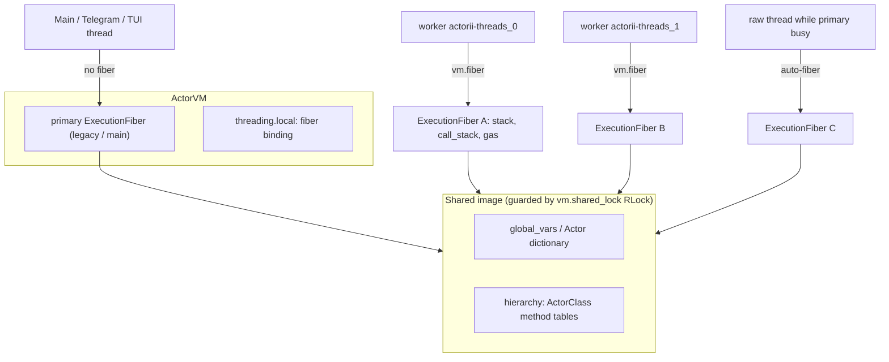

> [!WARNING]
> This is a planning document and should not be considered as a source of truth without verification.

# Multithreaded ActorII — Opt-In Fibers, Not Thread-Per-Object

**Owner:** `threads` · **Modules:** `src/actorii/vm.py` (fiber layer), `src/actorii/classes/concurrency.py` (primitives + `Actor[#Threads]` twin) · **Tests:** `tests/test_multithreaded_actor.py`

## 1. Goals & Non-Goals

| Goal | How |
|---|---|
| Concurrent `vm.eval_chunk(...)` / `vm.dispatch_message(...)` from many threads without stack corruption | Per-thread `ExecutionFiber` execution state |
| Existing single-threaded code runs **unchanged** | One *primary* fiber that every non-fiber thread shares (legacy semantics) |
| Bounded parallelism for Bilby harness fan-out (telemetry / sensors / memory probes) | `TaskPool` + `Actor[#Threads]` (`parallelAll`, `parallelMap`, `spawn*`) |
| Race-free coordination between tasks | `Future`, `Channel`, `Mutex`, `AtomicCounter` |
| Per-task gas metering, cancellation, shadow-run safety | Fiber-local `max_opcodes`, cooperative cancel (gas → 0), inherited `_in_shadow_run` |

**Non-goals:** every `ActorObject` becoming a thread/mailbox actor; CPU-parallel speedup of pure Actor bytecode under the CPython GIL (the win is overlapping I/O: LLM calls, Neo4j, HTTP, SSH, `nvidia-smi`, BLE sensors). Free-threaded CPython builds get true CPU parallelism from the same design.

## 2. Architecture



### 2.1 `ExecutionFiber` (vm.py)
A `__slots__` object holding everything execution-local:
`call_stack, halted, _in_run_loop, _last_popped, _opcodes_executed, max_opcodes, _instructions, _constants, _string_table, _pc, _stack, _local_vars, objects, next_obj_index, last_eval_opcodes, _last_failed_frame_info, _last_unhandled_selector, _in_shadow_run`.

`ActorVM` declares each of these as a `_FiberSlot` data descriptor, so **all existing code (`self.call_stack`, `vm.max_opcodes = …`, `vm._in_shadow_run`, harness `getattr(vm, "last_eval_opcodes")`) keeps working** — the descriptor routes the access to the calling thread's fiber. Fast path: when no private fiber exists anywhere (`_fiber_count == 0`) the lookup goes straight to the primary fiber without touching `threading.local`. The hot `run()` loop and `_execute_opcode` cache the fiber locally. Measured overhead on single-threaded micro-benchmarks: ~10–15%.

### 2.2 Fiber binding rules
1. `with vm.fiber(max_opcodes=…, shadow=…, name=…)` — explicit, nestable binding for the calling thread. Budget and shadow flag default to the *parent* fiber's values.
2. `eval_chunk`, `dispatch_message`, `eval_transactional` enter `_execution_scope()`:
   - already in a fiber → use it;
   - primary free or owned by this thread (re-entrancy) → claim primary (**legacy behaviour, including sequential hand-off between threads**, e.g. Telegram goal worker threads);
   - primary busy on *another* thread → transparently allocate an **auto-fiber** (`concurrency_stats["auto_fibers"]`).
3. Helpers: `vm.eval_isolated(src, max_opcodes=…)`, `vm.send_isolated(rcv, sel, args)`, `vm.send_message(...)` (alias), `vm.current_fiber`, `vm.in_fiber()`, `vm.active_fiber_count`, `vm.shared_lock`, `vm.concurrency_stats`.

### 2.3 Shared image locking
`vm.shared_lock` (`threading.RLock`) guards:
- `ClassDef` / `Now` / `Def` processing in `eval_chunk` (class registration, method compilation + attach);
- `STORE_GLOBAL` / `STORE_NAME` (paired `global_vars` + `Actor[...]` writes stay atomic).
The lock is never held while user Actor code runs, so tasks blocking on each other cannot deadlock through it.

## 3. Concurrency Primitives (`actorii.classes.concurrency`)

| Python | Actor class | Key selectors |
|---|---|---|
| `TaskPool(vm, max_workers, default_gas=None)` | — | `spawn`, `spawn_chunk`, `spawn_block`, `spawn_task`, `parallel_all`, `parallel_settle`, `parallel_map`, `await_all`, `shutdown` |
| `ActorThreadPoolTwin(vm, max_workers=8)` | `ThreadPool` → mounted as `Actor[#Threads]` | see §4 |
| `ActorFuture` | `Future` | `await(f, ms)`, `awaitOr(f, ms, default)`, `isDone`, `isRunning`, `status` (`#pending/#completed/#failed/#cancelled`), `error`, `value`, `cancel`, `elapsedMs`, `threadName`, `taskLabel` |
| `ActorChannel(capacity)` | `Channel` | `send(ch, v[, ms])`, `receive(ch, ms)`, `tryReceive`, `size`, `capacity`, `close`, `isClosed`, `drain` |
| `ActorMutex(vm)` | `Mutex` | `lock(m[, ms])`, `tryLock`, `unlock`, `isLocked`, `withLock(m, {block})` |
| `AtomicCounter(initial)` | `AtomicCounter` | `add(c, d)`, `increment`, `decrement`, `get`, `set`, `compareAndSet(c, old, new)` |

All handles returned to Actor code are capability-gated `ActorBridgeObject`s. The Actor classes are registered in `register_classes` as bridge classes (`is_bridge_class=True`) with class-level delegates (so `error(fut)!!` beats `Object>>error`) and constructors: `new(Channel, 8)`, `new(AtomicCounter, 0)`, `new(Mutex)`, `new(ThreadPool, 4)`.

### Task semantics
- Each task runs in a **fresh fiber** on a pool worker: isolated stack, call stack, gas budget (`gasLimit` → fiber `max_opcodes`).
- **Ordering:** `parallelAll` / `parallelMap` / `awaitAll` return an `Array` in **input order**, regardless of completion order.
- **Errors:** `await` and `parallelAll` re-raise the original task exception (e.g. `ZeroDivisionError`, `OpcodeBudgetExceededError`); `parallelSettle` never raises and returns `[status, value, error]` triples. On a fan-out failure/timeout the remaining tasks are cancelled.
- **Timeouts** are milliseconds; `nil`/negative = wait forever. Timeouts raise `ActorTaskTimeoutError` (a `TimeoutError`).
- **Cancellation:** queued tasks are cancelled outright; running Actor code is aborted cooperatively by forcing its fiber's gas budget to 0 (zero per-opcode cost). Python bridge calls already in flight (e.g. a sleeping HTTP request) finish first.
- **Shadow runs:** the submitter's `_in_shadow_run` flag is captured; tasks spawned inside `eval_transactional(..., shadow_only=True)` keep Tier 2 bridge commands blocked.
- **Nested fan-out:** awaiting a still-queued task from a worker of the same pool runs it inline (help-while-waiting), so a saturated pool cannot deadlock on nested `parallelAll`.

## 4. `Actor[#Threads]` contract (for `@integrator`)

Import: `from actorii.classes.concurrency import ActorThreadPoolTwin` (also re-exported by `actorii.classes`).
Mount: `vm.expose_object(ActorThreadPoolTwin(vm, max_workers=8), global_key="Threads")`.

| Selector | Tier | Signature |
|---|---|---|
| `spawn` | 2 (shadow-safe) | `spawn(Actor[#Threads], receiver, #selector, argsArray[, gasLimit])` → Future |
| `spawnChunk` | 2 (shadow-safe) | `spawnChunk(Actor[#Threads], "expr!!"[, gasLimit])` → Future |
| `spawnBlock` | 2 (shadow-safe) | `spawnBlock(Actor[#Threads], {using(x) …}[, argsArray, gasLimit])` → Future |
| `parallelAll` | 2 (shadow-safe) | `parallelAll(Actor[#Threads], tasksArray[, timeoutMs, gasLimit])` → Array |
| `parallelSettle` | 2 (shadow-safe) | `parallelSettle(Actor[#Threads], tasksArray[, timeoutMs, gasLimit])` → Array of `[status, value, error]` |
| `parallelMap` | 2 (shadow-safe) | `parallelMap(Actor[#Threads], itemsArray, receiver, #selector[, timeoutMs])` → Array (receiver `nil` ⇒ send to each item; receiver block ⇒ `block(item)`) |
| `awaitAll` | 0 | `awaitAll(Actor[#Threads], futuresArray[, timeoutMs])` → Array |
| `newChannel` / `newMutex` / `newCounter` | 0 | `newChannel(Actor[#Threads], capacity)`, `newMutex(Actor[#Threads])`, `newCounter(Actor[#Threads], initial)` |
| `sleepMs`, `currentThread`, `maxWorkers`, `activeTasks`, `stats`, `summary` | 0 | diagnostics |
| `shutdown` | 2 | `shutdown(Actor[#Threads])` |

Task specs in `tasksArray`: string chunk `"expr!!"`, block `{…}`, `[receiver, #selector, args]` triple, or an existing Future.

> [!NOTE]
> "shadow-safe" Tier 2: allowed during transactional dry-runs because the spawned tasks inherit the shadow flag, so any *real* side effect inside them is still blocked.

## 5. Bilby harness benefits

- **Parallel probe fan-out** — one step gathers GPU, memory, sensor and web state concurrently; latency = slowest probe, not the sum:
  ```actor
  probes := parallelSettle(Actor[#Threads], #(
      "gpuStatus(Actor[#Valkyrie])!!"
      "recallEpisodes(Actor[#Memory], \"thermopro\", 5)!!"
      "summary(Actor[#Telegram])!!"), 8000)!!
  ```
- **Background tasks** — kick off a slow manual ingest, keep reasoning, then join:
  ```actor
  job := spawnChunk(Actor[#Threads], "learnProduct(Actor[#ProductLearner], \"TP358\", \"BLE\")!!", 2000000)!!
  /* ...other steps... */
  awaitOr(job, 60000, #stillRunning)!!
  ```
- **Producer/consumer pipelines** with bounded `Channel`s (sensor sampler → anomaly detector) and `AtomicCounter` / `withLock` for shared tallies:
  ```actor
  ch := newChannel(Actor[#Threads], 32)!!
  total := 0!! m := newMutex(Actor[#Threads])!!
  parallelAll(Actor[#Threads], #("withLock(m, {total := total + 1})!!" "withLock(m, {total := total + 1})!!"), 1000)!!
  ```
- **No thread-per-object bloat:** N objects ≠ N threads; a fixed `max_workers` pool multiplexes any number of tasks, and the main harness loop keeps using the primary fiber exactly as before.

## 6. Safety guarantees & caveats

1. Per-thread stacks/frames/gas: concurrent evaluations cannot corrupt each other's operand or call stacks (stress-tested with 16 concurrent threads × 3 rounds).
2. Shared-image writes are atomic per operation; **read-modify-write sequences across statements are not** — use `Mutex`/`withLock` or `AtomicCounter`.
3. Object-level state (`ActorObject._fields`, Python bridge targets) is shared; bridge targets used from tasks must be thread-safe or guarded by a `Mutex`.
4. `eval_transactional` rollback is image-global: concurrent tasks that write globals during another thread's rollback may be reverted. Keep transactional evaluation and background writers separate.
5. Non-local return (`^` inside a block) cannot cross threads; a block spawned onto a worker that does `^x` fails its Future.
6. Low-level `vm.load()` + `vm.run()` pairs are not scope-claimed; use `eval_chunk` / `dispatch_message` (or wrap in `vm.fiber()`) from concurrent threads.
7. Pool threads are joined at interpreter exit; call `shutdown(Actor[#Threads])!!` (or `TaskPool.shutdown()`) to cancel queued work and abort running Actor loops.

## 7. Verification

```bash
cd /home/skippy/projects/ActorII && ACTORII_STATE_DIR=/tmp/actorii_threads_test ACTORII_MEMORY_NAMESPACE=pytest_threads \
  PYTHONPATH=src pytest tests/test_multithreaded_actor.py tests/test_vm.py tests/test_vm_execution.py tests/test_class_library.py -q
```
Coverage: fiber isolation/nesting/back-compat, 16-thread `eval_chunk` stress, concurrent `dispatch_message` and `Def`, Future value/error/timeout/gas/cancel, `parallelAll` 4×50 ms < 110 ms speedup and deterministic order, `parallelSettle`/`parallelMap`/`spawnBlock`, Channel producer–consumer (4×250 items, bounded + close), Mutex/AtomicCounter contention, shadow-run inheritance, nested fan-out deadlock avoidance, shutdown, selector contract.
