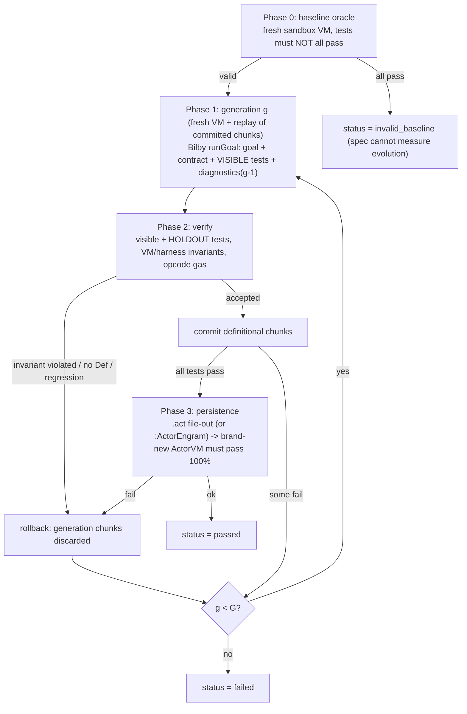

> [!WARNING]
> This is a planning document and should not be considered as a source of truth without verification.

# Bilby Self-Evolution Loop Benchmark

Module: `src/actorii/harness/self_evolution_bench.py` · CLI: `scripts/run_self_evolution_benchmark.py` · Tests: `tests/test_self_evolution_benchmark.py`

## 1. What it measures

The existing `Actor[#Bench]` kata (`benchmark.py`) checks *one-shot* task completion. This benchmark asks a
harder question: **can `Actor[#Bilby]` grow a new, general capability into a live `ActorVM` image over several
self-evolution generations, using only deterministic feedback, and does that capability survive a clean reload?**

Every verdict comes from a deterministic oracle (Actor 4.1 test expressions plus optional restricted Python
oracles). There is no LLM judge, no mock data and no synthetic confidence score.

## 2. State machine



* **Rollback is replay based.** The committed capability is a list of definitional chunks (`inherit` / `now` /
  `Def`). Each generation starts from a *fresh* bootstrapped VM and replays only accepted chunks, so a rejected
  generation cannot leak state. Probe chunks, assignments and `storeScratch` calls are never committed.
* **Gates (Phase 2)** — a generation is rolled back when: (a) a core invariant breaks (`(6*7)==42`, `Actor[#Harness]`
  present, `AgentHarness` / protected system class fingerprints unchanged — Ring-1 selectors may be allowed per spec
  with `allow_harness_mutation`), (b) harness + verification opcodes exceed `gas_budget`, (c) it defined no `Def`
  method, or (d) it scored fewer passing tests (visible + holdout) than the best committed state, including the
  pre-evolution baseline (anti-regression).
* **Diagnostics to generation g > 1:** visible failures (expression, expected, got/error), harness step errors,
  linter errors, invariant violations, and for the hidden holdout only the pass count and failing *category tags*.
  Holdout expressions are never shown.
* **Anti reward-hacking.** `reward_hacking_suspected` is raised when all visible tests pass but a holdout test fails
  (e.g. a hard-coded lookup table). The generation is not counted as a success.
* **Persistence (Phase 3).** `require_persistence=True` file-outs each `required_classes` entry through
  `ActorFileOutManager`, boots a brand-new VM (plus `reload_setup_source` only), loads the `.act` files and re-runs
  100% of visible + holdout tests. `--persistence-backend engram` instead round-trips through `saveEngram` /
  `loadEngram` on `Actor[#Memory]` (Neo4j, isolated namespace). If the backend is unavailable the gate fails with the
  real error — there is no silent fallback.

## 3. Modes

| mode | solver | determinism | cost |
|---|---|---|---|
| `scripted` | per-spec `scripted_generations`: gen 1 intentionally flawed, gen 2 correct. Gen 2 is only emitted if the harness actually fed diagnostics into the prompt (`PREVIOUS GENERATION DIAGNOSTICS` marker), so the diagnostics wiring is itself under test. | fully deterministic | ~2 s for the whole suite |
| `live` | real Bilby (`AgentHarness>>runGoal`) over an OpenAI-compatible endpoint, default `http://127.0.0.1:8080/v1`, `qwen3.8:latest`, `temperature=0.0`, `seed=42`, thinking disabled | as deterministic as the server (greedy decoding + seed) | minutes |

The live provider is installed as the harness `custom_provider` (so `ai.py` is untouched) and sends the harness
system prompt + the full step prompt. LLM transport errors are recorded as `llm_error` on the generation, never
masked.

## 4. Spec schema (`EvolutionSpec`, JSON-loadable)

| field | meaning |
|---|---|
| `spec_id`, `name` | identifiers (`[A-Za-z0-9_-]+`) |
| `difficulty` | `tier1_method` (extend an existing class), `tier2_class_engram` (new class), `tier3_harness_policy` (harness-aware helper) |
| `goal`, `spec_prompt` | what Bilby is asked to build and the exact behavioural contract / selectors |
| `visible_tests` | `[{"expr", "expected", "tag"?, "oracle"?}]` or `[expr, expected]` — shown to Bilby |
| `holdout_tests` | same shape — hidden; `oracle` is a restricted Python expression over `result` (e.g. `"result == sorted(result)"`) |
| `max_generations` (3), `max_steps_per_gen` (8), `gas_budget` (400000) | loop limits; gas = harness opcodes + oracle opcodes |
| `require_persistence`, `required_classes` | Phase 3 reload gate |
| `setup_source` | environment loaded into baseline + every generation VM (e.g. an existing class to extend) |
| `fixture_source` | loaded right before tests, never persisted (e.g. a fake harness) |
| `reload_setup_source` | supporting classes for the Phase 3 reload VM |
| `scripted_generations` | scripted-mode solver sources (list of strings, one per generation) |
| `allow_harness_mutation`, `test_opcode_cap` | tamper-check relaxation; per-test opcode cap |

Test `expr` may contain several `!!` chunks; the value of the last chunk is compared (`1`/`True`, floats with 1e-9
tolerance, Symbols normalised to `"#name"`, collections to lists, Dictionaries to dicts, `null` = nil).
Oracles are evaluated with a tiny builtins whitelist; spec files are trusted input, this is not a security sandbox.

### Minimal custom spec (`--spec-file`)

```json
{
  "specs": [{
    "spec_id": "doubler",
    "name": "Doubler",
    "difficulty": "tier2_class_engram",
    "goal": "Create class Doubler with twice(self, x).",
    "spec_prompt": "`twice(self, x)` returns x * 2.",
    "visible_tests": [["Actor[#d] := new(Doubler)!! twice(Actor[#d], 4)!!", 8]],
    "holdout_tests": [
      {"expr": "Actor[#d] := new(Doubler)!! twice(Actor[#d], -3)!!", "expected": -6, "tag": "negative"},
      {"expr": "Actor[#d] := new(Doubler)!! twice(Actor[#d], 0)!!", "expected": 0, "tag": "zero"}
    ],
    "required_classes": ["Doubler"],
    "scripted_generations": ["inherit(Object, #Doubler, #(#u), 1, nil)!! now(Doubler)!! Def twice(self, x) { ^(x * 2); }!!"]
  }]
}
```

A spec file may hold one object, a list, or `{"specs": [...]}`. `--mode live` does not need `scripted_generations`.

## 5. Built-in suite

| id | tier | what Bilby must build |
|---|---|---|
| `sensor_window_median` | 1 | add `median` to the live `SensorWindow` class (sorted copy, integer even-count average, no mutation of insertion order) |
| `ring_buffer_telemetry` | 2 | `RingTelemetry`: bounded window, eviction, sum/mean/min/max, nearest-rank percentile, MAD anomaly detector |
| `circuit_breaker_policy` | 2 | `CircuitBreaker`: closed / open / half-open with explicit tick clock, single probe, trip count |
| `dag_task_scheduler` | 2 | `TaskScheduler`: Kahn topological order with smallest-id tie-break, cycle detection, `depthOf` |
| `harness_step_budget_advisor` | 3 | `StepBudgetAdvisor`: inspects an `AgentHarness`-shaped object (`stepLog`/`stepCount`/`maxSteps`) to detect A-A-A / A-B-A-B oscillation, trailing failures, adaptive remaining budget; also checked against the real `Actor[#Harness]` |
| custom | any | any `--spec-file` JSON |

## 6. Metrics

Per spec: `status` (`passed | failed | invalid_baseline | error`), `pass_at_1`, `pass_at_g`, `generations_used`,
`steps_used`, `gas_used` (= harness opcodes + oracle verification opcodes; class/method *definitions* cost 0 opcodes, so
the number mostly reflects runtime cost of the evolved capability), `holdout_pass_rate`, `visible_pass_rate`,
`persistence_verified`, `latency_s`, `rollbacks`, `reward_hacking_suspected`, `baseline` counts and a `generations[]`
trace (outcome, rollback reason, per-gen pass counts, invariant violations, llm stats).
Suite summary: `pass@1`, `pass@G`, mean generations, mean holdout rate, persistence count, rollbacks, errors, totals.

## 7. Usage

```bash
cd /home/skippy/projects/ActorII
export ACTORII_STATE_DIR=/tmp/actorii_evo_test ACTORII_MEMORY_NAMESPACE=pytest_evo

# deterministic CI run (no LLM)
PYTHONPATH=src python scripts/run_self_evolution_benchmark.py --mode scripted --specs all --strict \
    --output-json /tmp/selfevo_scripted.json --output-md /tmp/selfevo_scripted.md

# live Bilby on the local llama-server (never loads a new model; uses what is pinned on :8080)
PYTHONPATH=src python scripts/run_self_evolution_benchmark.py --mode live \
    --specs sensor_window_median,circuit_breaker_policy --output-json /tmp/selfevo_live.json

# tests (live test is opt-in)
PYTHONPATH=src pytest tests/test_self_evolution_benchmark.py -q
ACTORII_RUN_LIVE_EVO=1 PYTHONPATH=src pytest tests/test_self_evolution_benchmark.py -q -k live
```

Exit codes: `0` ok, `1` `--strict` with a failed spec, `2` spec/config error or an erroring/invalid spec.

From inside the VM (wired by `@integrator`): `selfEvoSuites(Actor[#Bench])!!`,
`runSelfEvo(Actor[#Bench], #ring_buffer_telemetry, #scripted)!!`.

## 8. Isolation & safety

* `SelfEvolutionRunner` scopes `ACTORII_STATE_DIR` (to its work dir), `ACTORII_MEMORY_NAMESPACE` (unique per run),
  `ACTORII_DISABLE_DEMO_TWINS=1` and `ACTORII_HOST_LOCKDOWN=1` for the duration of a run and restores them afterwards
  (`--allow-host` opts out of the lockdown). `~/.actorii` is never written.
* Each generation runs in a throw-away VM (`enable_memory_graph=False` unless the engram backend is selected).
* No GPU models are loaded; live mode only issues chat completions to the already-running endpoint.

## 9. VM quirks discovered while building the reference solutions

Found by this benchmark's reference solvers and reported on the board (#9):

1. `x := f(self)` did not overwrite a local `x` that already held a value when `f` returned `nil`.
2. `^(f(self) == nil)` raised `IndexError: pop from empty list` when `f` returned from inside a `loop` body.
   (1) and (2) share one root cause in `vm.py` (`_pop_frame` dropped explicit `nil` returns); **fixed by `@threads` (#19)**
   with regressions in `tests/test_multithreaded_actor.py`. The reference solutions keep the defensive style
   (sentinel `-1`, results copied to locals) so they stay valid on older images.
3. `now` is a reserved word and cannot be used as a parameter name (spec prompts and the generic syntax reminder say so).
4. A malformed `Def` inside a multi-chunk evaluation is silently ignored instead of raising, which is why a generation
   needs at least one real `Def` to count as defining anything.

The generic `ACTOR 4.1 SYNTAX REMINDER` in every live prompt (ivar access, prefix calls, locals, `if`/`loop` forms,
integer `/`, "unknown selector returns nil") is language documentation, identical for all specs; it contains no
spec-specific hints.

## 10. Open items

* Live pass rates are a property of the served model; scripted mode only proves the state machine and oracles.
* `final_source` accumulates superseded chunks across accepted generations (replay-correct but not compacted).
* Engram backend is exercised only when Neo4j (`:7687`) is reachable.
