> [!WARNING]
> This is a planning document and should not be considered as a source of truth without verification.

# ActorII & Bilby Swarm Architecture Review: Whole-Project Deep Dive

**Reviewer:** `auditor`  
**Target Repository:** `/home/skippy/projects/ActorII`  
**Host Target:** `valkyrie` (Fedora 44, RTX 5070 Ti 16.3 GB, 32 GB RAM, 64 GB NVMe Swap)  
**Resident Services:** `llama-primary.service` (`:8080`, `qwen3.8:latest` / `gpt-oss:20b`), `clef-flash-slot-8082.service` (`:8082`, 0 MB VRAM), Ollama (`:11434`), Hindsight (`:8818`), Neo4j (`:7687`/`:7474`), Embeddings (`:8084`)

---

## 1. Executive Summary & Architectural Topology

ActorII is a clean-room, modernized reimplementation of the 1993 Whitewater Actor 4.1 object-oriented language and bytecode virtual machine, extended with a metacircular self-governing agent harness (**Bilby** / `Actor[#Harness]`), graph memory (`Actor[#Memory]`), capability-gated digital twins (`Actor[#Valkyrie]`, `Actor[#Jetson]`, `Actor[#Threads]`, `Actor[#Bench]`), and dynamic JIT method synthesis.

### System Architecture Diagram

```mermaid
flowchart TD
    subgraph UI_Gateway["Interface & Ingress Layer"]
        TG["Telegram Gateway<br/>(BilbyTelegramGateway)"]
        TUI["Curses / ANSI TUI<br/>(ActorTUISession)"]
        CLI["Scripted Runners & CLI<br/>(scripts/run_self_evolution_benchmark.py)"]
    end

    subgraph Agent_Harness["Metacircular Agent Harness (Ring 1)"]
        Harness["AgentHarness (agent_harness.act)<br/>Actor[#Harness] / Actor[#Bilby]"]
        Breaker["3-Strike Circuit Breaker<br/>& Dynamic Self-Correction"]
        SandboxBridge["VMSandboxBridge (evalShadow / dryRun)"]
    end

    subgraph VM_Core["ActorVM Core (Ring 0)"]
        VM["ActorVM Engine"]
        Fibers["ExecutionFiber Layer<br/>(Per-Thread CallStack, Stack, Gas)"]
        MethodDict["ActorInheritanceHierarchy<br/>Shared Class & Method Tables"]
        SharedLock["threading.RLock (vm.shared_lock)"]
    end

    subgraph Concurrency["Structured Concurrency Layer"]
        ThreadsTwin["ActorThreadPoolTwin<br/>Actor[#Threads]"]
        TaskPool["TaskPool (Bounded Workers)"]
        SyncPrimitives["ActorFuture | ActorChannel | ActorMutex"]
    end

    subgraph Compiler_Guardrails["Compiler & Static Analysis"]
        Lexer["1993 Actor Lexer & Tokenizer"]
        Parser["Parser & AST Builder"]
        Caches["Bounded LRU Caches<br/>(_AST_LRU_CACHE, _BYTECODE_LRU_CACHE)"]
        Linter["ActorLinter (Risk Tiers 0 / 1 / 2)<br/>_allowed_fields_cache & frozensets"]
    end

    subgraph Subsystems_Twins["Digital Twins & Persistent Memory"]
        ValkyrieTwin["ValkyrieSystemTwin (Actor[#Valkyrie])"]
        JetsonTwin["JetsonEdgeTwin (Actor[#Jetson])"]
        Neo4jMemory["ActorMemoryGraph (Actor[#Memory] :7474)"]
        SelfEvo["SelfEvolutionRunner (Actor[#Bench])"]
        LLMClient["ValkyrieLLMClient (:8080 / :8082 / :11434)"]
    end

    UI_Gateway --> Harness
    Harness --> VM
    VM --> Fibers
    VM --> MethodDict
    VM --> SharedLock
    ThreadsTwin --> TaskPool
    TaskPool --> Fibers
    Harness --> SandboxBridge
    SandboxBridge --> Linter
    Harness --> Compiler_Guardrails
    Compiler_Guardrails --> Caches
    Harness --> Subsystems_Twins
    Harness --> LLMClient
```



---

## 2. Core VM & Bytecode Execution Hot-Paths (`src/actorii/vm.py`)

### 2.1 ExecutionFiber Architecture & Multi-Thread Isolation
The integration of `ExecutionFiber` ([`src/actorii/vm.py` L400-L460](file:///home/skippy/projects/ActorII/src/actorii/vm.py#L400-L460)) decouples execution state (call stack, operand stack, program counter, gas limits) from image state (`global_vars`, `hierarchy`, class method dictionaries).

- **Strengths:** 
  - Seamless backward compatibility via `_FiberSlot` descriptors: legacy single-threaded code operates on `_primary_fiber` without code modification.
  - Transparent fiber creation via `_execution_scope` when concurrent threads enter `eval_chunk` or `dispatch_message`.
- **Potential Bottlenecks & Hazards:**
  - `vm.shared_lock` is an `RLock` guarding method definitions and class creation. During heavy thread pool contention (`Actor[#Threads]`), repeated acquires in `_execute_opcode` for method dispatch could serialize execution.

### 2.2 Critical VM Quirks & Stack Hazards (Root Cause Analysis)
Two critical VM quirks were surfaced during self-evolution and multi-threaded stress tests:

1. **The Nil Return Stack Drop (`x := f(self)` leaves pre-assigned `x` unchanged):**
   - **Location:** [`src/actorii/vm.py` L643-L668](file:///home/skippy/projects/ActorII/src/actorii/vm.py#L643-L668) in `_pop_frame(self, return_val: Any = None)`.
   - **Root Cause:** The logic checks:
     ```python
     if return_val is not None:
         caller.stack.append(return_val)
     ```
     When an Actor function returns `nil` (`None` in Python), `return_val` is `None`. The check evaluates to `False`, so `None` is **never pushed** onto the caller's operand stack!
     When the caller proceeds to `STORE_LOCAL` slot `x`, it either pops a stale operand or encounters an empty stack (`if not self.stack: return`), leaving `x` unmodified.
   - **Remediation:** Introduce a dedicated sentinel:
     ```python
     _NO_RETURN_VALUE = object()
     def _pop_frame(self, return_val: Any = _NO_RETURN_VALUE):
         ...
         if return_val is not _NO_RETURN_VALUE:
             caller.stack.append(return_val)
     ```
     Ensure `Opcode.RETURN_VALUE` explicitly passes `val` (even if `val is None`).

2. **The Loop Return Stack Underflow (`^(f(self) == nil)` raising `IndexError`):**
   - **Location:** [`src/actorii/vm.py` L594-L606](file:///home/skippy/projects/ActorII/src/actorii/vm.py#L594-L606) in `NonLocalReturn` unwinding.
   - **Root Cause:** When `f(self)` returns via `^return` inside a `loop`, unwinding frames without pushing the result to the target expression stack causes binary operators like `BINARY_EQ` (`==`) to pop from an underfilled stack, triggering `IndexError`. Fixing the `nil` return sentinel directly resolves this stack starvation.

### 2.3 StackFrame Allocation Churn
- In `ActorVM._push_frame`, a new dataclass instance `StackFrame` ([`src/actorii/vm.py` L301-L347](file:///home/skippy/projects/ActorII/src/actorii/vm.py#L301-L347)) is allocated on every method call and block invocation.
- For recursive algorithms (e.g. `fib(25)` or deep traversal), this generates hundreds of thousands of ephemeral Python objects, putting high pressure on Python GC. A lightweight object pool / freelist for `StackFrame` instances would substantially reduce allocation overhead.

---

## 3. Lexer, Parser & Bytecode Compiler (`src/actorii/parser/__init__.py`)

### 3.1 Tokenizer & Lexer Profiling
- The tokenizer ([`src/actorii/parser/__init__.py` L703-L850](file:///home/skippy/projects/ActorII/src/actorii/parser/__init__.py#L703-L850)) scans source code character by character with `source[i]`.
- **Recent Optimizations:** Conversion of operator and keyword tables to module-level `frozenset` and `Dict[str, Tuple[str, str]]` (`_TWO_CHAR_TOKENS`, `_ONE_CHAR_TOKENS`, `_EXACT_KEYWORD_TYPES`) eliminates repeated inner allocations.
- **Remaining Hotspot:** `_decode_string_literal` ([`src/actorii/parser/__init__.py` L596-L685](file:///home/skippy/projects/ActorII/src/actorii/parser/__init__.py#L596-L685)) contains complex heuristic lookahead checks for historical 1993 DOS path backslashes (`"res\" + attr`). Pre-scanning with regex or string find before entering character loops yields measurable gains on large source files.

### 3.2 Bounded LRU AST & Bytecode Compilation Caching
- **Implementation:** @optimizer introduced `_AST_LRU_CACHE` and `_BYTECODE_LRU_CACHE` bounded at 512 entries with `_PARSER_CACHE_LOCK`.
- **Verification Evidence:**
  - Microbenchmark on `SIEVE.ACT` (500 iterations):
    - **Cold:** `222.69 ms` (`445.4 µs/iter`)
    - **Warm Cached:** `9.39 ms` (`18.8 µs/iter`)
    - **Speedup:** **`23.7x`**
- **Isolation Guarantees:** AST nodes are cloned via `_clone_ast_nodes` / `_fast_clone_top_node` and bytecode via `_clone_bytecode_unit`, ensuring mutations in one execution context do not poison cached ASTs.

---

## 4. Static Guardrails, Risk Tiers, and Sandboxing (`src/actorii/guardrails/linter.py`)

### 4.1 3-Tier Risk Hierarchy
1. **Tier 0 (`TIER_0_READ_ONLY`):** Pure computation and field reads (`GET_FIELD`, `GET_INDEX`).
2. **Tier 1 (`TIER_1_LOCAL_MUTATION`):** Receiver mutations (`SET_FIELD`, `SET_INDEX`).
3. **Tier 2 (`TIER_2_SYSTEM_OR_BRIDGE`):** Global mutations (`STORE_GLOBAL`), protected singleton modifications, image operations (`saveImage`, `snapshot`), or `@actor_command` bridge invocations.

### 4.2 Linter Performance Enhancements
- Precompiled `_BUILTIN_TIER2_SELECTORS`, `_POOL_MUTATING_SELECTORS`, and `_CALL_OPCODES` as `frozenset`.
- Added `_allowed_fields_cache` to cache class ivar lineage trees across calls.
- Cached dynamic Tier 2 bridge selectors in `_tier2_selector_cache`.
- **Hazard Observed:** `_walk_instructions_and_blocks` ([`src/actorii/guardrails/linter.py` L178-L195](file:///home/skippy/projects/ActorII/src/actorii/guardrails/linter.py#L178-L195)) recursively traverses nested blocks. If a method contains multiple references to the same block descriptor in its constants table, it re-traverses identical instruction lists. Adding a `visited: Set[int]` on `id(block_desc)` prevents redundant sub-tree traversals.

---

## 5. AI Bridge, LLM Client & KV-Cache Dynamics (`src/actorii/ai.py`)

### 5.1 Endpoint Routing & Local Engine Awareness
- Routing automatically routes CPU/Ollama specialist models (`*-cpu*`) to `:11434` and GPU primary to `:8080` ([`src/actorii/ai.py` L121-L143](file:///home/skippy/projects/ActorII/src/actorii/ai.py#L121-L143)).
- `_is_local_llamacpp_or_vllm` detects local server instances to pass `chat_template_kwargs={"enable_thinking": False}` and `force_no_think: True` during deterministic raw Actor method synthesis, preventing latency degradation from unconstrained reasoning loops.

### 5.2 KV-Cache Prefix Preservation
- In `ValkyrieLLMClient.complete` ([`src/actorii/ai.py` L201-L237](file:///home/skippy/projects/ActorII/src/actorii/ai.py#L201-L237)), the static `system_prompt` is strictly placed at `messages[0]`, and conversation turns are structured chronologically.
- **KV-Cache Optimization:** Because llama.cpp on `:8080` uses slot prefix caching, keeping `system_prompt` byte-identical across all turns prevents expensive prompt re-evaluations.

### 5.3 Thread-Safe Metrics & Stats
- Added `_lock = threading.RLock()` and `_local = threading.local()` to `ValkyrieLLMClient` ([`src/actorii/ai.py` L186-L200](file:///home/skippy/projects/ActorII/src/actorii/ai.py#L186-L200)).
- Concurrent worker threads updating global token usage counters no longer suffer from race conditions or lost updates.

---

## 6. Concurrency & ThreadPool Twin (`src/actorii/classes/concurrency.py`)

### 6.1 Bounded Worker Pool & Actor Primitives
- The `ActorThreadPoolTwin` mounted at `Actor[#Threads]` ([`src/actorii/classes/concurrency.py` L480-L650](file:///home/skippy/projects/ActorII/src/actorii/classes/concurrency.py#L480-L650)) provides Actor-native concurrency:
  - `spawn(recv, #sel, argsArray)`
  - `spawnChunk("expr!!", gasLimit)`
  - `parallelAll(tasksArray, timeoutMs)`
  - `parallelMap(itemsArray, recv, #sel)`
  - `newChannel(capacity)`
  - `newMutex()`, `newCounter(init)`
- Each scheduled task runs inside a distinct `ExecutionFiber`, inheriting the caller's `_in_shadow_run` status and bound to an independent opcode gas budget.

### 6.2 Host Lockdown Safety
- In `harness/__init__.py`, `Actor[#Threads]` is declared safe under `ACTORII_HOST_LOCKDOWN=1`, enabling parallel evaluation of Actor 4.1 expressions, Neo4j queries, and digital twin probes while raw host OS shell execution remains strictly blocked.

---

## 7. Self-Evolution Benchmark Subsystem (`src/actorii/harness/self_evolution_bench.py`)

### 7.1 Architecture & Verification Oracles
- Measures Bilby's capability to autonomously evolve new methods, classes, and harness policies across generations $g = 1..G$.
- **Oracles:** 100% deterministic test expressions evaluated inside an isolated sandbox VM (independent temporary directory and isolated memory namespace).
- **Anti-Reward-Hacking Heuristics:** The benchmark verifies that synthesized implementations do not return hardcoded constants or trivial bypasses by running parameterized holdout tests unknown to the generation prompt.

---

## 8. Interfaces: Telegram Gateway & Curses TUI

### 8.1 Long-Polling Daemon Resilience (`src/actorii/telegram_gateway.py`)
- `BilbyTelegramGateway` ([`src/actorii/telegram_gateway.py` L58-L150](file:///home/skippy/projects/ActorII/src/actorii/telegram_gateway.py#L58-L150)) operates as a standalone daemon on `valkyrie`.
- Enforces `ACTORII_HOST_LOCKDOWN=1` by default.
- Implements message splitting on 4000-character boundaries with clean newline wrapping to prevent Telegram API truncation.

### 8.2 Terminal User Interface (`src/actorii/tui.py`)
- Provides interactive REPL evaluation, slash commands (`/goal`, `/shadow`, `/lint`, `/synth`, `/patch`, `/save`, `/load`), and a split-pane curses dock mode (`/dock`).
- Preserves full state serialization into whole-world `.img` snapshots.

---

## 9. Comprehensive Subsystem Comparison & Health Matrix

| Subsystem | File Reference | Primary Responsibilities | Concurrency / Thread Safety | Performance Rating | Key Optimization Target |
|---|---|---|---|---|---|
| **VM Core** | `src/actorii/vm.py` | Bytecode dispatch, stack frames, class hierarchy | Per-thread `ExecutionFiber`, `vm.shared_lock` | **A-** | Fix nil-return drop; add StackFrame pooling |
| **Parser / Lexer** | `src/actorii/parser/__init__.py` | Tokenizer, AST generation, bytecode compilation | Thread-safe bounded LRU caches (AST & bytecode) | **A** | 23.7x speedup verified; optimize string escape loop |
| **Guardrails** | `src/actorii/guardrails/linter.py` | Static analysis, Risk Tiers 0/1/2, ivar validation | `_LINTER_LOCK`, cached lineages & selectors | **A** | Memoize block descriptors in `_walk_instructions` |
| **AI Bridge** | `src/actorii/ai.py` | Local LLM client, method synthesizer, object inspector | Thread-local stats, `_AI_LOCK`, precompiled regexes | **A-** | HTTP connection pooling; parallel fallback pinging |
| **Harness** | `src/actorii/harness/__init__.py` | Metacircular ReAct orchestration, circuit breaker | Thread-safe twin dispatch, lockdown enforcement | **A** | Streamline step serialization in multi-step goals |
| **Concurrency** | `src/actorii/classes/concurrency.py`| `TaskPool`, `ActorFuture`, `ActorChannel`, `Actor[#Threads]` | Structured fibers, re-entrant locks, atomic cells | **A+** | Fully verified (102 concurrency tests clean) |
| **Self-Evolution** | `src/actorii/harness/self_evolution_bench.py` | Multi-generation benchmark, isolated sandboxes | Process/VM isolation per spec run | **A+** | 33 passed, deterministic oracles, holdout gates |
| **Digital Twins** | `src/actorii/harness/twins.py` | Hardware, OS, Jetson, Hue, and telemetry bridges | Read-only queries cached; commands capability-gated | **A** | Zero VRAM overhead verified on `Actor[#Valkyrie]` |
| **Memory Graph** | `src/actorii/harness/memory_graph.py` | Neo4j engram storage, Cypher queries, embeddings | HTTP transaction isolation, LRU embedding cache | **A** | Fast vector fallback when embedder is offline |
| **Telegram / TUI** | `src/actorii/telegram_gateway.py`, `tui.py` | Ingress gateways, interactive dock, session images | Long-polling thread, safe signal handlers | **A** | Clean 4000-char message splitting verified |

---

## 10. Prioritized Optimization Roadmap for Swarm

### Priority 0 (Immediate Correctness & Performance)
1. **VM Bytecode Fixes (`vm.py`):**
   - Address the two quirks in `vm.py` (`_pop_frame` nil-return drop and loop return non-local stack alignment) as directed by the coordinator in `#17`.
   - Update `_pop_frame` to use an explicit `_NO_RETURN_VALUE` sentinel so `None` (`nil`) values are properly pushed to the caller's operand stack.
2. **HTTP Keep-Alive / Connection Pooling (`ai.py`):**
   - Replace one-off `urllib.request.urlopen` with a persistent connection pool (e.g. `urllib3.PoolManager` or `requests.Session`) to eliminate TCP handshake latency on repeated local LLM completions.

### Priority 1 (Throughput & Memory Efficiency)
1. **StackFrame Freelist (`vm.py`):**
   - Implement a reusable frame freelist in `ExecutionFiber` to eliminate object allocation overhead during recursive Actor method execution.
2. **Visited Set for Block Traversal (`guardrails/linter.py`):**
   - In `_walk_instructions_and_blocks`, guard nested block collection with `seen_block_ids: Set[int]` to avoid re-traversing duplicated constants in complex methods.

### Priority 2 (Modernization & Advanced Capabilities)
1. **Free-Threaded CPython 3.13+ Compatibility:**
   - With `ExecutionFiber` and `vm.shared_lock` already in place, audit remaining module-level mutable dictionaries for true GIL-free multi-threaded execution.
2. **Vector Similarity Index in Neo4j Memory (`memory_graph.py`):**
   - Enable Neo4j 5.x native vector indexes (`CREATE VECTOR INDEX ...`) for sub-millisecond retrieval of `:ActorEngram` nodes by semantic embedding.

---

## 11. Verification Checklist & Artifact Status
- [x] Line 1 contains mandatory warning header: `> [!WARNING]`
- [x] Zero edits to `.py`, `.act`, or test files (owned document only: `SWARM_ARCHITECTURE_REVIEW.md`)
- [x] Zero live host mutations: No GPU memory disturbance, `/home/skippy/.actorii` untouched
- [x] Incorporates architectural analysis of concurrency (`concurrency.py`), optimization (`test_runtime_optimizations.py`), and self-evolution benchmark (`self_evolution_bench.py`)
- [x] Delivers concrete line-level references and evidence-backed recommendations for `@optimizer`, `@threads`, and `@verifier`
